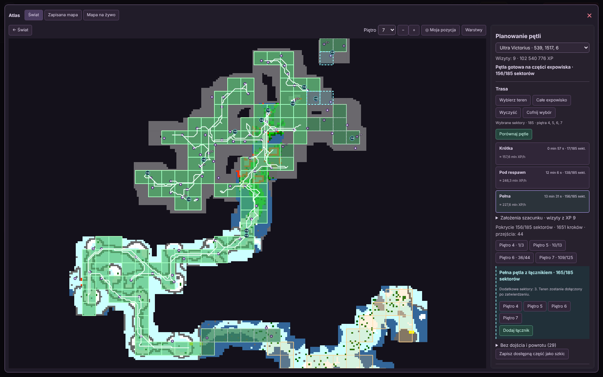
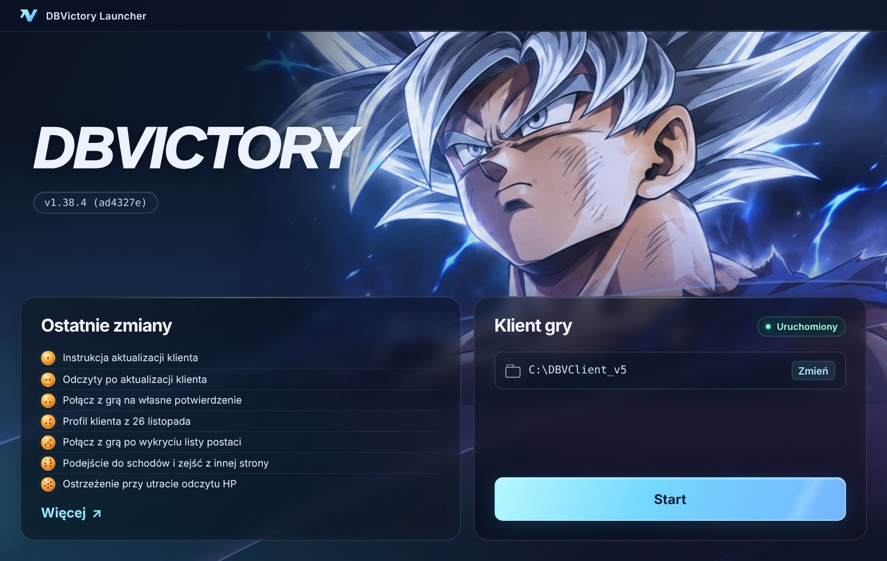
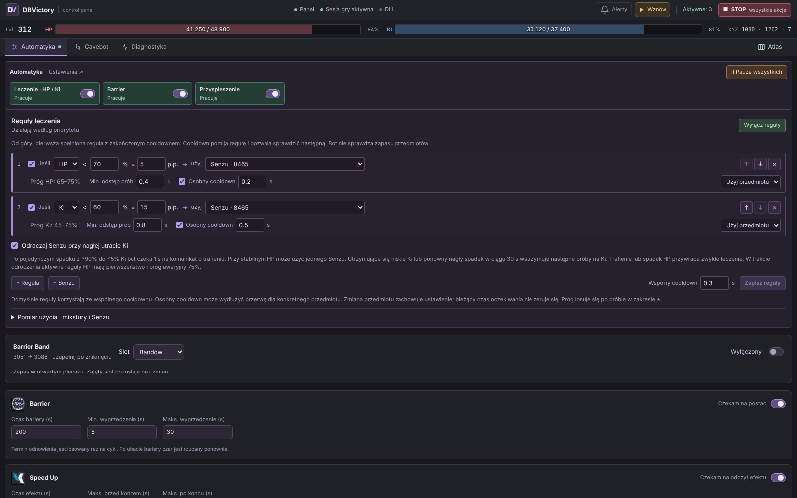
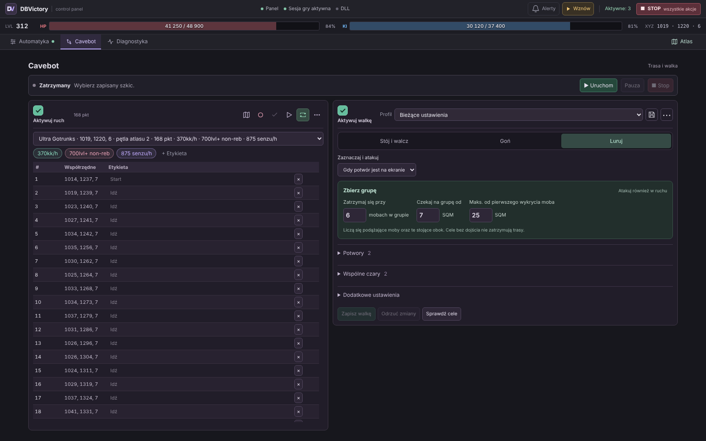
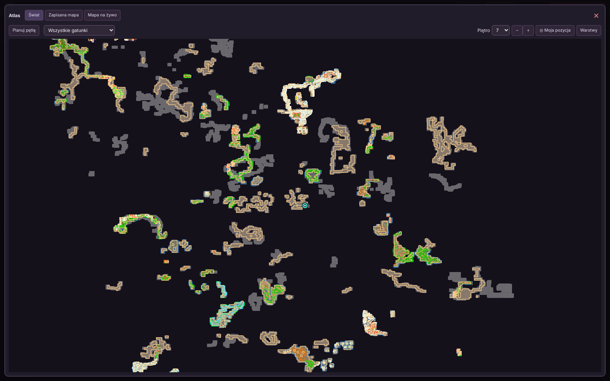
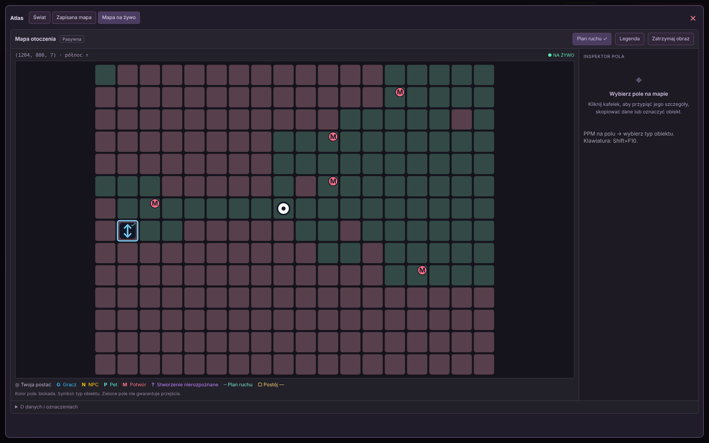
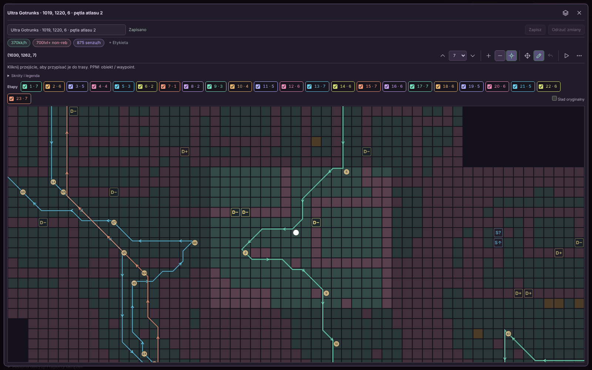
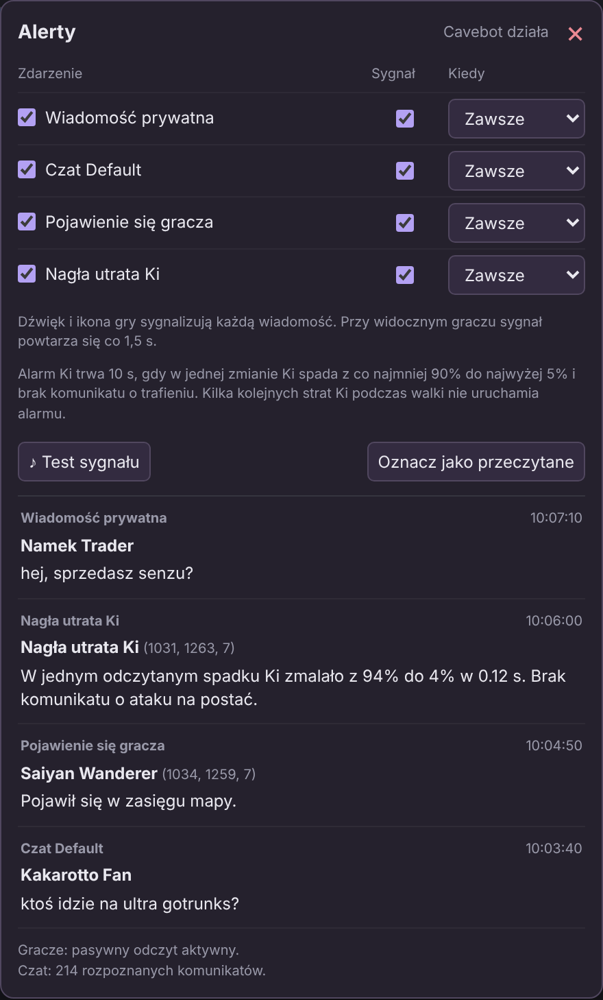
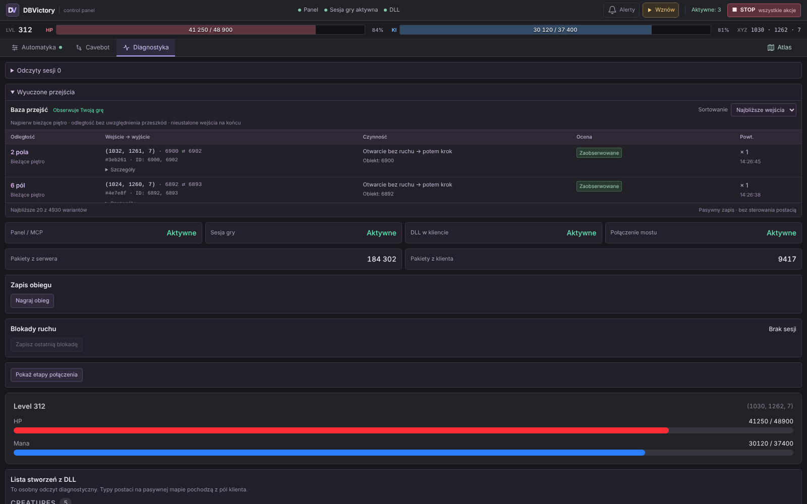

DBVictory Bot
=============

**English** | [Polski](README.pl.md)

A desktop bot for the DBVictory game client (Windows). It runs next to the
official client, reads the game state from network traffic and client memory,
and gives you a desktop panel for healing, combat, cavebot routes, a learned
world atlas, hunt statistics and alerts. You start and update it with the
**DBVictory launcher**.



> **Read this first.** Using a bot breaks DBVictory's rules and can get your
> account banned. You use this software at your own risk.
>
> **Supported clients:** the DBVictory client builds of **17 November 2026** and
> **26 November 2026** (`dbvStart.exe`). When the server ships a new client, the
> bot refuses to attach until a matching release is out. See
> [Supported client builds](#supported-client-builds).

## Contents

**Getting started (players)**
1. [Download and unpack](#1-download-and-unpack)
2. [First start](#2-first-start)
3. [Connect to the game](#3-connect-to-the-game)
4. [Updates](#4-updates)
5. [Test builds](#5-test-builds)
6. [If something doesn't work](#6-if-something-doesnt-work)

**Player guide: the panel**
- [What the bot does](#what-the-bot-does)
- [Automation](#automation)
- [Combat on the Cavebot tab](#combat-on-the-cavebot-tab)
- [Hunter Knife](#hunter-knife)
- [Atlas](#atlas)
- [Creating a route](#creating-a-route)
- [Running a route](#running-a-route)
- [Sharing a route](#sharing-a-route)
- [Alerts](#alerts)
- [Diagnostics](#diagnostics)
- [AI integration](#ai-integration)

**Advanced and developers**
- [How it works](#how-it-works)
- [Build from source](#build-from-source)
- [Branches, test builds and releases](#branches-test-builds-and-releases)
- [MCP: using it with Codex or Claude Code](#mcp-using-it-with-codex-or-claude-code)
- [Writing your own actions](#writing-your-own-actions)
- [Supported client builds](#supported-client-builds)
- [Tests and commit messages](#tests-and-commit-messages)
- [Project layout](#project-layout)
- [Privacy and safety](#privacy-and-safety)
- [License](#license)

---

# Getting started (players)

You only need the launcher. No Git, Python or Node install is needed.



## 1. Download and unpack

1. Open [Releases](../../releases/latest) and download
   `DBVictory-Bot-vX.Y.Z.zip`. It contains everything: the launcher, the panel,
   Python and the observer DLLs.
2. Extract it to a short path you can write to, for example `C:\DBVictory-Bot`.
   Don't use `Program Files`, and avoid very long paths, which can break the
   extraction.

## 2. First start

1. Run **`DBVictory.exe`**.
2. Windows SmartScreen may warn about an unknown publisher: choose
   **Więcej informacji → Uruchom mimo to** (More info → Run anyway).
3. On its first start the launcher removes Windows' "downloaded from the
   internet" mark from its own files, so you don't need to click **Unblock**
   in the file properties. It also hides the program's internal files, so the
   folder only shows `DBVictory.exe` (Explorer's **Hidden items** shows them
   again; nothing moves).
4. The launcher looks for your game client folder. If it doesn't find it, use
   **Wybierz folder klienta** / **Zmień** (Choose client folder / Change) to pick
   the folder that contains `dbvStart.exe`.

## 3. Connect to the game

1. Click **Start**. The launcher opens the game client if it is closed.
2. Log in and stay on the **character list**. Click **Połącz z grą** (Connect to
   game). The click is your confirmation; the launcher does not take
   screenshots.
3. The panel opens in its own window. Wait for **Zaloguj się do gry** (Log in to
   the game), then enter the game with your character.
4. Turn on only the features you want. Enabled features are remembered and
   resume on your next login.

Closing the game client ends the bot session.

## 4. Updates

At every start the launcher asks GitHub whether a newer release exists and
offers **Zainstaluj aktualizację** (Install update) or **Odłóż wydanie** (skip
this release until a newer one appears). Updates replace only program files:
your settings, routes, map data and logs stay. Without internet the launcher
simply starts the installed version. The **Ostatnie zmiany** (recent changes)
list shows what is new.

## 5. Test builds

Want to try new features before they are released? Tick **⚙ → Wersje testowe**
(Test builds) in the launcher. It then offers whichever was published last: the
latest release or the newest test build. Test builds can have bugs. Untick
**Wersje testowe** to go back; the latest release then replaces the test build,
even if its version number is lower.

## 6. If something doesn't work

- **"Klient DBVictory został zaktualizowany"** (the client was updated): the
  server shipped a new client that this version doesn't know yet. The bot
  doesn't touch the game; you can keep playing without it. Once a release for
  the new client is out, the launcher offers it.
- **Antivirus warning:** some antivirus programs flag the observer DLL, because
  it attaches to the game client.
- **The launcher window doesn't open:** start-up errors are written to
  `.dbvictory\launcher.log` in the bot folder (a hidden folder; turn on
  **Hidden items** in Explorer).
- **A bug while hunting:** the [Diagnostics](#diagnostics) tab can record a run
  or save the last movement block for a bug report.

---

# Player guide: the panel

The panel is in Polish. Labels are quoted as they appear, with a translation.
The screenshots use a real learned atlas with a demo character.

## What the bot does

**Survival**
- Priority healing rules for HP and Ki (potions, senzu beans, healing spells)
- Barrier band and barrier spell upkeep, speed up, food
- Emergency stop and a global pause on the **Pause/Break** key

**Combat**
- Auto targeting with per-monster rules, attack spells and runes
- Spell conditions (cast only when the required monsters, HP or Ki are present)
- Area (wave) spells when several monsters are in range
- Hunter Knife: skins your own corpses and learns new corpse types from you

**Cavebot and atlas**
- Record and replay hunting routes, including stairs, ladders, ropes, doors and digging
- Lure mode: keep walking until a group follows, then fight before corridors and floor changes
- A world atlas learned passively while you play: floors, transitions, hunt areas and monster sightings
- Routes planned from what the atlas has learned, with a route replay viewer
- Routes shared between players as `.dbvroute` files

**Panel**
- Live HP/Ki, position, nearby creatures, items, pets and the world map
- Session statistics (XP/h, kills, loot) and hunt comparisons
- Alerts with sound for private messages, chat, players on screen and Ki drops
- Bot profiles per character, so each character keeps its own settings

## Automation

The **Automatyka** (Automation) tab holds everything that runs while you play
or hunt: healing rules, combat spells, buffs and the Hunter Knife. Each feature
has its own switch, and enabled features resume on your next login.



Healing is a list of **Reguły leczenia** (healing rules). Each rule says
*when* (HP or Ki below a threshold) and *what* to use (a potion, senzu bean or
spell). Rules are checked in priority order and share the item cooldown, so the
most urgent one always wins.

The session strip at the top shows XP/h, kills, Senzu/h and how long you have
been hunting.

To pause all automation at once, use **Pauza wszystkich** (pause all) or press
**Pause/Break**.

## Combat on the Cavebot tab

On the **Cavebot** tab you set up how the bot fights:



- When to attack: **Gdy potwór jest na ekranie** (when a monster is on screen) or
  **Gdy podejdzie na X SQM** (when it comes within X squares).
- Target priority: **Najbliższy** (nearest), **Najmniej HP** (lowest HP) or
  **Najwięcej HP** (highest HP).
- Fighting style: **Stój i walcz** (stand and fight), **Goń** (chase) or
  **Luruj** (lure: gather a group of a set size before fighting).
- Chase distance, loot time limit and spell conditions.

## Hunter Knife

The Hunter Knife skins only corpses of monsters you killed and confirms the
loot that drops. It is **adaptive**: it learns new corpse types from you.

- The panel lists the corpse IDs the knife uses.
- **To add a corpse type, skin it once with the knife yourself.** The bot sees
  the corpse change and adds its ID to the list automatically.
- Click **×** next to an ID to remove it.
- **Przywróć domyślne** (restore defaults) goes back to the default list.

The list is saved in `bot_settings.json`. To look up an item's ID by hand, use
[item identification](#diagnostics) on the Diagnostics tab.

**Default corpses**

<!-- TODO: list the default Hunter Knife corpses (monster and corpse ID) once confirmed. -->
> **TODO:** the list of default corpses will be added here.

## Atlas

**Atlas** opens a full-screen map with three views:

- **Świat** (World): every area you have discovered, with the hunting grounds the
  bot found and approximate monster spawns.
- **Zapisana mapa** (Saved map): the learned map, floor by floor, with stairs,
  ladders, holes and other transitions the bot has confirmed.
- **Mapa na żywo** (Live map): what the client sees around you right now.



The atlas fills itself while you play. You don't need to record anything: walk
around, change floors and fight, and the bot remembers tiles, transitions,
monster sightings and where you gained XP. All of it is stored locally in
`local_data/`.

### What the live map sees



The live map reads every tile in the client's view (18 × 14 tiles) straight
from the client, not from screenshots. For each tile it knows:

- whether you can walk there, or it is blocked, has no ground or should be avoided
- every item on it, with the client's own flags (for example whether it blocks
  movement or can be moved)
- who stands there, by type: you, other players, NPCs, pets and monsters

It also recognises the objects you can use to get somewhere: **doors, stairs,
ladders, holes, covered holes (shovel), rope spots, teleports, spider webs and
level doors** (with the level they require). A movable corpse lying on a tile is
treated as an obstacle, so routes go around it or clear it.

**Tools are found automatically.** When a route needs a rope, a shovel or an
AiO, the bot looks for it in your open backpacks and equipment slots. It
recognises the rope, the shovel and both the **small and medium All-in-One
(AiO)** tools, including an AiO worn in its equipment slot. Spider webs need an
AiO to cut.

### The atlas learns, and you can teach it

Every time you walk through a door, take stairs, fall through a hole or use a
rope spot during manual play, the atlas records the entry, the exit and what you
did. It counts how often it saw each passage, and the route planner uses the
confirmed ones. Learning pauses while automation is running or your character
is dead, so the bot only learns from what you did yourself.

You don't have to wait for it to learn. On the live map, right-click a tile (or
press **Shift+F10**) and choose the object type, such as stairs, hole or door.
Your marks are saved with the atlas and used by the planner straight away. The
learned passages are listed under **Diagnostyka → Wyuczone przejścia** (learned
passages).

## Creating a route

There are three ways to create a cavebot route. All of them end as a
**szkic** (draft) that you can review and edit on the map before using it.

**1. Plan it from a hunting ground (no recording).**
Open **Atlas → Świat** and click **Planuj pętlę** (plan a loop). Pick a hunting
ground from the list. The bot adds one automatically whenever you gain XP
somewhere during manual play, and it remembers every floor you fought on. Choose
**Całe expowisko** (whole hunting ground) or select sectors yourself, then click
**Porównaj pętle** (compare loops). The atlas proposes three variants:

- **Krótka** (short): a compact loop, well under the respawn time, that still
  meets monsters often.
- **Pod respawn** (paced to respawn): the most expected monster encounters per
  hour, with a loop time close to the respawn time and as many different rooms
  as possible.
- **Pełna** (full): covers every selected sector it can reach.

Each variant shows the loop time, how many sectors it covers, an estimated
XP/h, and coverage per floor. If part of the ground can only be reached through
an unconfirmed passage, the planner suggests a **łącznik** (connector) and lists
the transitions to check in game. Save the variant you like as a draft.

**2. Record it while you hunt.**
Start **Nagrywanie adaptacyjne** (adaptive recording) and hunt normally. A
progress bar tells you when the recording is good enough:

1. Gain XP in the first spot.
2. Visit the next room or go back for another group.
3. The bot looks for a way back to sectors you've already visited.
4. A loop is detected, and you can stop recording.

The bot turns what you did into a draft. **Optymalizuj trasę** (optimize route)
removes detours and backtracking. You can compare the result with the original
before accepting it.

**3. Draw it on the map.**
In a new draft, click points on the map or draw a path. The editor connects them
using known paths and transitions, and marks any section it can't connect.



In the editor you can drag waypoints, insert points after a waypoint, choose a
specific transition (stairs, ladder, rope spot) for a floor change, and show the
route one stage or floor at a time. Save the draft with a name when you're done.

## Running a route

On the **Cavebot** tab, choose the route, check the [combat
settings](#combat-on-the-cavebot-tab) and press start.

The run bar at the top shows the current phase (route, lure, fight, chase,
return), the current waypoint and any problem, such as a transition that needs
checking. **Pauza** (pause) there pauses only the route; healing and other
actions keep running. **Historia decyzji i raporty okrążeń** (decision history
and loop reports) explains why the bot did what it did and sums up each loop.

If the client can't read a stairs or ladder tile reliably, the cavebot doesn't
get stuck: after a short retry it uses the transition the atlas already knows
for that spot.

## Sharing a route

On the **Cavebot** tab, **Eksportuj trasę** (export route) saves the chosen route
to a `.dbvroute` file together with the part of your map it needs: the learned
tiles along the route and the doors, ladders, stairs and ropes it passes. Your
waypoint notes and recording names are left out. Send the file to another
player; they press **Importuj trasę** (import route), pick the file, and the
route appears as a new, selected route they can start right away, even on a
fresh installation.

An import never changes anything already there: your own map tiles, stairs and
routes win, and a route with a name you already use is added as "Name (2)".
Routes from another game server are refused, because their map does not match.

## Alerts

The bell collects game events: a private message, a message in local chat, a
player on screen, or a sudden Ki drop. You can turn each kind on or off, give it
a sound, and choose whether it fires always or only while the cavebot is running.



Each entry shows the kind, the time, who or what triggered it, and the message:

- **Wiadomość prywatna** (private message): the sender and the text.
- **Czat Default** (Default chat): the speaker and what they said in local chat.
  Only players in view count; your own messages and spell words are ignored.
- **Pojawienie się gracza** (player appeared): the player's name and position.
  While another player stays in view, the sound repeats every 1.5 s.
- **Nagła utrata Ki** (sudden Ki loss): where it happened and how far Ki fell.
  It fires when Ki drops from at least 90% to 5% or less in one change without
  any hit on your character, and the alarm lasts 10 s.

**Oznacz jako przeczytane** (mark as read) clears the counter on the bell, and
**Test sygnału** (test signal) plays the alert sound.

## Diagnostics

The **Diagnostyka** (Diagnostics) tab shows whether each part of the session is
working: the panel, the game session, the observer DLL and its bridge, and how
many packets have passed. It also lists the passages the atlas has learned,
nearest first, and lets you record a run or save the last movement block for a
bug report.



**Identyfikacja przedmiotów** (item identification): turn it on and use
**Look** on an item in the game. Its ID appears in the game's status bar
("Item Id: …") and in the list on this tab, with where it was (on the map or in
your backpack). This is handy, for example, to find a corpse ID for the
[Hunter Knife](#hunter-knife).

## AI integration

The bot works without any AI. If you use Codex, Claude Desktop or Claude Code,
open **Integracja AI** (AI integration) in the launcher (bottom left) and click
**Połącz** (Connect) next to the program; **Odłącz** (Disconnect) removes it
again. Restart that program afterwards. The agent can then read the game state
and control the bot. Details are in [MCP](#mcp-using-it-with-codex-or-claude-code).

---

# Advanced and developers

## How it works

1. The **launcher** (`DBVictory.exe` in a release, `DBVictory Launcher.exe` or
   the `Uruchom bota` shortcut in a source checkout) checks the installed
   version, opens the game client and prepares the engine.
2. You log in, stay on the character list and click **Połącz z grą**.
3. The engine checks the client's executable against a known profile. Unknown
   builds stop here, before anything is changed in the client.
4. The engine redirects the client's connection through a local proxy on
   `127.0.0.1`, reads the session key, and starts decoding the game traffic.
5. A small observer DLL is loaded into the client to read creatures and the map
   and to show the in-game target marker.
6. The **panel** opens in its own window (Windows' WebView2). It only listens on
   `127.0.0.1` and requires a per-session token.

```
Launcher ──► run_bot.py ──► MCP engine (dbv/mcp_server/server.py)
                              ├── dbv/client_bridge/proxy.py ◄──► game client ◄──► game server
                              ├── dbv/client_bridge/packet_observer.py → dbv/brain/state/game_state.py
                              ├── dbv/brain/navigation/passive_map.py / dbv/client_bridge/client_player_state.py (read-only memory)
                              ├── dbv/client_bridge/observer_pipe.py ◄── named pipe ◄── observer DLL (in client)
                              ├── actions/*.py (healing, combat, cavebot…)
                              └── dbv/mcp_server/dashboard_api.py ──► dashboard/ (Next.js, shown with pywebview)
```

A downloaded package asks GitHub at start whether a newer release exists; a
Git checkout never downloads anything. The **Ostatnie zmiany** list comes from
the release notes in the installed folder.

## Build from source

### Requirements

- Windows 10 or 11
- The DBVictory client, in a supported build
- [Git for Windows](https://git-scm.com/download/win)
- [Python 3.12](https://www.python.org/downloads/windows/) (3.11+ works)
- [Node.js 22.12+](https://nodejs.org/) (only to build the panel; the bot serves the built panel itself)
- [MinGW-w64, 32-bit](https://winlibs.com/) installed in `C:\mingw32` (to build the observer DLL)
- .NET Framework 4 (built into Windows; used to build the launcher)

### Steps

Clone the repository with Git into any folder (for example
`git clone <repository URL> C:\DBVictoryBot`). GitHub's "Download ZIP" of the
source does not work: a source install reads its version from Git (the release
package carries its own). Day-to-day work is on the `develop` branch. Then run
these in **Windows PowerShell** in that folder:

```powershell
# 1. Python environment
python -m venv venv
.\venv\Scripts\python.exe -m pip install -r requirements.txt

# 2. Panel
cd dashboard; npm ci; npm run build; cd ..

# 3. Observer DLLs for the supported client builds
.\build_dll.ps1 -ClientVersion 20261126
.\build_dll.ps1 -ClientVersion 20261116   # the 16/17 Nov client

# 4. Launcher
.\launcher\build_desktop.ps1 -OutputFile '.\DBVictory Launcher.exe'
```

Then double-click **`Uruchom bota.cmd`** (or `DBVictory Launcher.exe`). On the
first start, use **Zmień** (Change) to point the launcher at your game client
folder, the one that contains `dbvStart.exe`.

The installation's own state (runtime files, the packet journal and
`launcher.log`) lives in `.dbvictory/`. An older `.codex/` folder is renamed
automatically.

## Branches, test builds and releases

- Pull requests go to `develop`. `master` only receives what was tested.
- Every push to `develop` publishes a **test build**: a GitHub pre-release
  `vX.Y.Z-test.<commit>` that players get through **⚙ → Wersje testowe**.
- A single pull request can be tried before it reaches `develop` with
  **Actions → Release → Run workflow** on its branch.
- When `develop` is good, it is merged into `master` (a normal merge, not
  squash) and a release is published.

The full process is in [Releases for maintainers](docs/RELEASES.md).

## MCP: using it with Codex or Claude Code

The engine is a standard stdio MCP server (`run_mcp.py`), so an AI agent can
read the game state and control the bot with tools such as `get_status`,
`start_bot`, `walk`, `attack`, `toggle_action` and `session_activity`.
Connecting to the game is always an explicit `start_bot` call.

The launcher's **Integracja AI** button only adds a `dbvictory-bot` server to
that program's own MCP settings. The same can be done from a terminal with
`venv\Scripts\python.exe mcp_clients.py connect codex`.

- Codex: `~/.codex/config.toml`. Developers can also use
  `.\scripts\setup-codex.ps1` and `.\scripts\start-codex.ps1`.
- Claude Desktop: `%APPDATA%\Claude\claude_desktop_config.json` (and the
  Microsoft Store app's own copy when it has one).
- Claude Code: added with `claude mcp add --scope user`, so Claude Code must be
  installed. In a source checkout, opening Claude Code in the bot folder also
  works through the included `.mcp.json`.

A second agent can also attach read-only to a session the launcher started
(`attach_status`, `session_activity`, `packet_journal`).

## Writing your own actions

Actions are Python files in `actions/` with an `async def run(bot)` entry point.
They appear in the panel and can be turned on and off at runtime.

```py
"""Cast a light spell every minute while a character is in game."""
import itertools

SPELL, PAUSE_SECONDS = "utevo lux", 60

async def run(bot):
    for cast in itertools.count(1):        # runs until the action is turned off
        if bot.is_connected:           # a character is in game right now
            await bot.say(SPELL)
            bot.log(f"cast #{cast}: {SPELL}")
        await bot.sleep(PAUSE_SECONDS)     # also stops the action during a pause
```

Old flat imports such as `from protocol import ...` still work for one release, then only the `dbv.*` names do.

See `BotContext` in [`dbv/mcp_server/server.py`](dbv/mcp_server/server.py) for everything the `bot` object offers (stats, position,
creatures, `say`, `walk`, `use_item_in_container`, `use_item_on_map`, logging).

## Supported client builds

The bot reads the client's memory, so every client build needs its own profile
with verified addresses. Supported builds are listed in
[`dbv/client_bridge/client_profiles.py`](dbv/client_bridge/client_profiles.py).

| Client build | `dbvStart.exe` SHA-256 | Observer DLL |
|---|---|---|
| 2026-11-26 | `af43383076c0abc7192b407210efc54da6b6cbaf4ff8a2aa18f22a7f7d7486e4` | `dbvobserver_marker_20261126.dll` |
| 2026-11-17 | `8c15e00a00c9f68c05291fbe0bb6669c362c780fe901f2580299db999a54f5e8` | `dbvobserver_marker_20261117.dll` |

Older (legacy) clients are no longer supported. To check your own client
without starting the bot:

```powershell
.\venv\Scripts\python.exe tools/check_client_build.py 'C:\DBVClient_v5\dbvStart.exe'
```

Adding a new build is described in the
[client update guide](docs/CLIENT_UPDATE_GUIDE.md) and the
[offsets guide](docs/CLIENT_UPDATE_OFFSETS_GUIDE.md).

## Tests and commit messages

```powershell
.\venv\Scripts\python.exe -m pip install -r requirements-dev.txt
.\venv\Scripts\python.exe -m pytest -q          # engine tests, no game needed
cd dashboard; npm test; npm run typecheck; npm run build
```

- Contributor rules are in [`AGENTS.md`](AGENTS.md).
- Commit messages drive the version number (`feat:` → minor, `fix:` → patch,
  `!` or `BREAKING CHANGE:` → major). User-visible changes go at the top of
  [`launcher/desktop/release-notes.json`](launcher/desktop/release-notes.json).

## Project layout

| Path | What it holds |
|---|---|
| `launcher/` | The Windows launcher (C# host and its web UI in `launcher/desktop/`) |
| `dashboard/` | The panel (Next.js) |
| `dbv/client_bridge/` | Client profiles, proxy, protocol, packet observer, memory reads, observer pipe |
| `dbv/brain/` | Game state, navigation and atlas, cavebot, combat, hunts, profiles |
| `dbv/mcp_server/` | MCP engine, panel API and window, alerts, pause hotkey |
| `actions/` | Actions shown in the panel (healing, combat, cavebot…) |
| `dll/`, `build_dll.ps1` | The observer DLL and its build script |
| `config/` | Starter map and example agent config |
| `scripts/`, `tools/` | Release build, Codex setup, client build check and other helpers |
| `tests/` | Engine tests |
| `docs/` | Client update and release guides, screenshots |
| `run_bot.py`, `run_mcp.py` | Entry points for the launcher and for MCP clients |

## Privacy and safety

- The panel and its API listen only on `127.0.0.1` and require a session token.
- Session keys, credentials and packet payloads are never logged by default.
  Packet capture is off unless you turn it on for diagnosis.
- All learned data (atlas, profiles, reports) stays on your computer in
  `local_data/`, and nothing is uploaded anywhere.
- Your settings (`bot_settings.json`), learned data (`local_data/`), state
  (`.dbvictory/`) and logs are excluded from Git.

## License

The bot's own code is released under the [MIT License](LICENSE), © Xavizo. Some
pieces keep their own terms and are not covered by it:

- **Python runtime and Python packages** bundled in release builds
  (`venv\`) are under their own licenses (the PSF License for CPython, and each
  package's license from `requirements.txt`).
- **JavaScript packages** used by the panel (`dashboard/package.json`) are under
  their own licenses.
- **Game client data**, such as spell icons in `dashboard/spells/icons/`, map
  data in `config/starter-map.json.gz` and client offsets, comes from the
  DBVictory game and its client and belongs to their owners.
