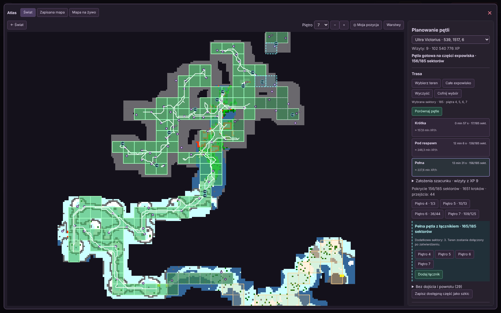
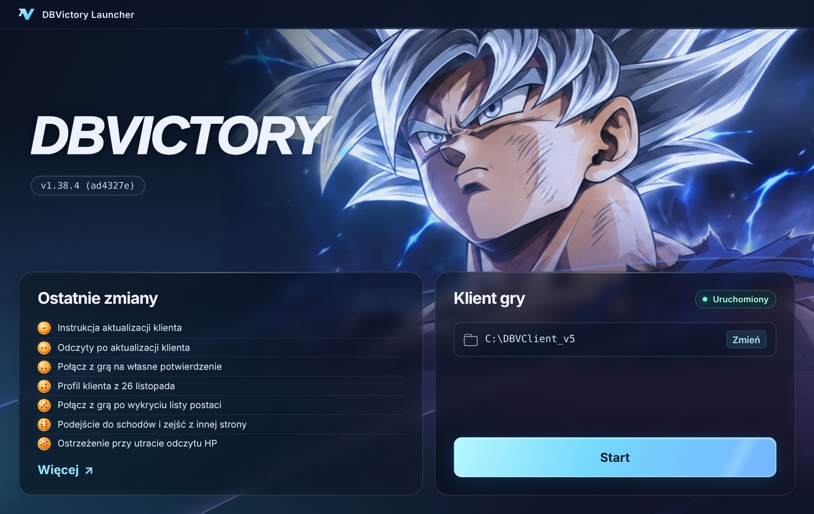
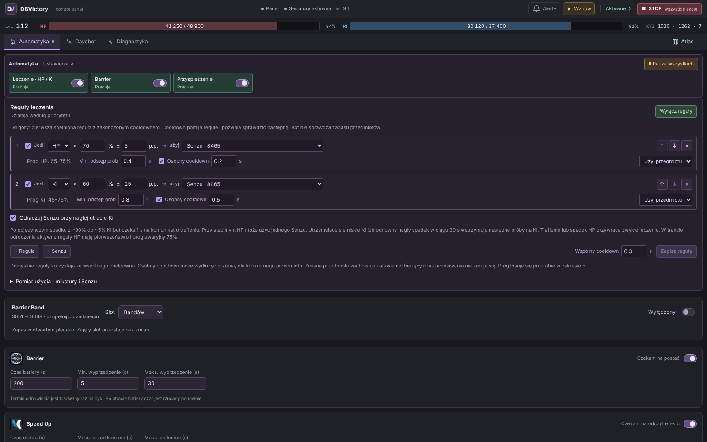
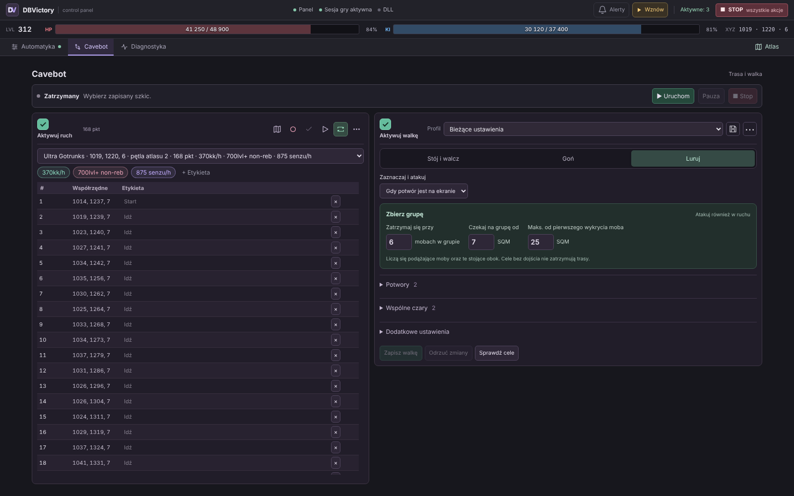
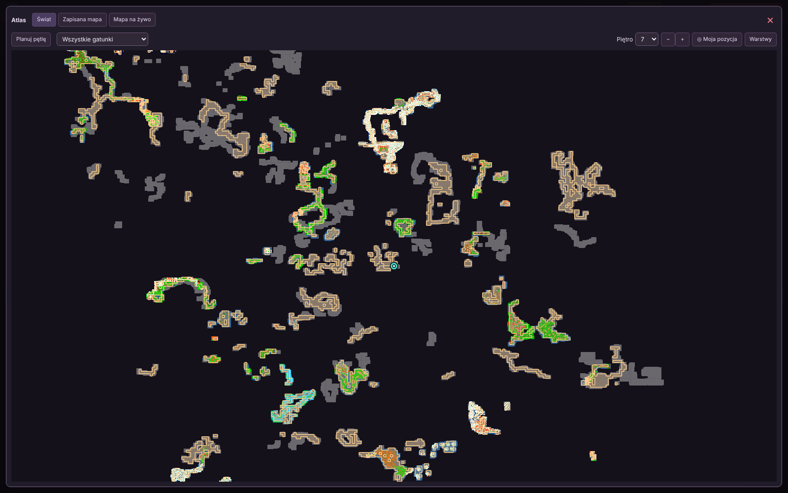
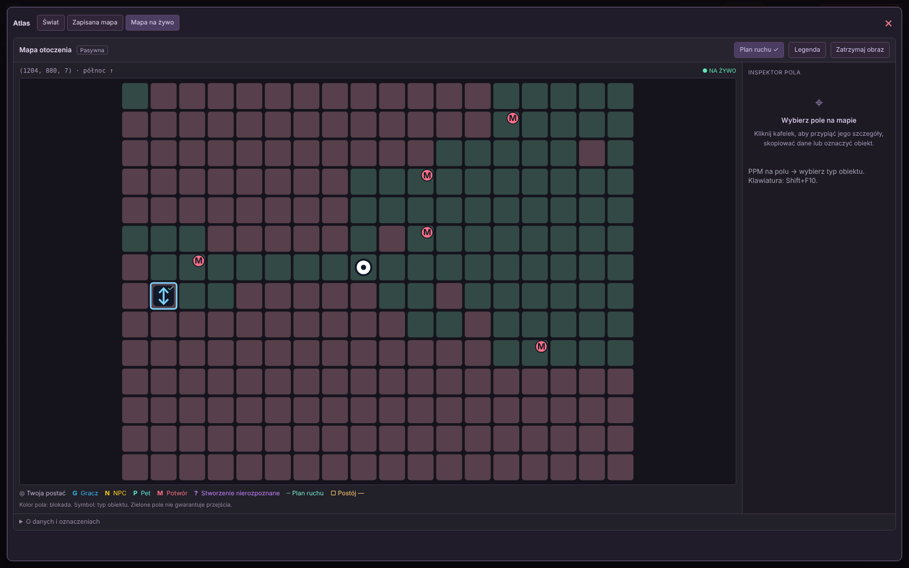
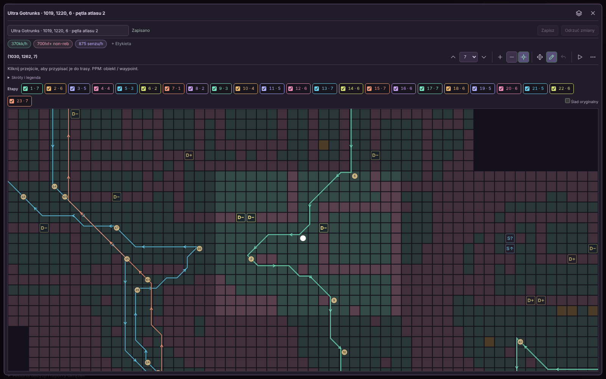
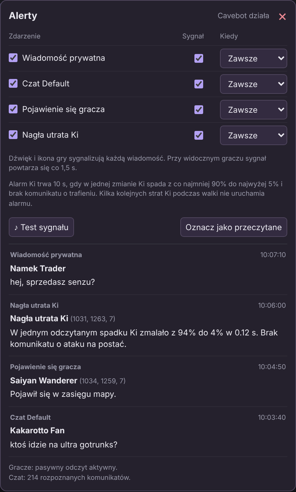
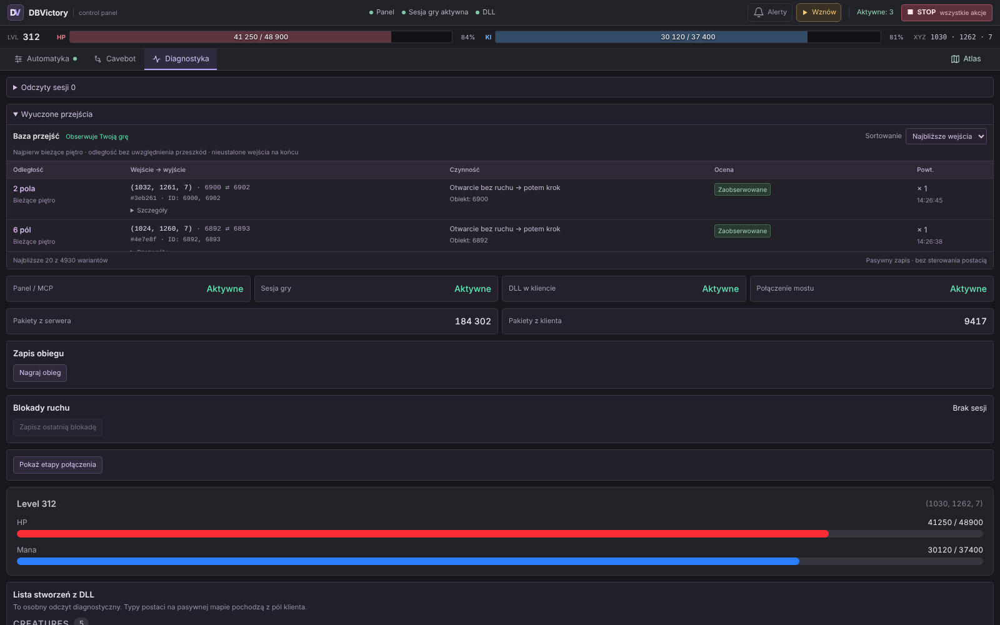

DBVictory Bot
=============

[English](README.md) | **Polski**

Bot desktopowy do klienta gry DBVictory (Windows). Działa obok oficjalnego
klienta, odczytuje stan gry z ruchu sieciowego i pamięci klienta, i daje panel
do leczenia, walki, tras cavebota, uczonego atlasu świata, statystyk polowań
i alertów. Uruchamiasz go i aktualizujesz przez **launcher DBVictory**.



> **Przeczytaj najpierw.** Używanie bota łamie zasady DBVictory i może
> skończyć się banem konta. Korzystasz z tego oprogramowania na własne ryzyko.
>
> **Obsługiwane klienty:** wersje klienta DBVictory z **17 listopada 2026**
> i **26 listopada 2026** (`dbvStart.exe`). Gdy serwer wyda nowego klienta, bot
> nie połączy się z grą, dopóki nie pojawi się pasujące wydanie. Zobacz
> [Obsługiwane wersje klienta](#obsługiwane-wersje-klienta).

## Spis treści

**Pierwsze kroki (dla graczy)**
1. [Pobierz i rozpakuj](#1-pobierz-i-rozpakuj)
2. [Pierwsze uruchomienie](#2-pierwsze-uruchomienie)
3. [Połącz z grą](#3-połącz-z-grą)
4. [Aktualizacje](#4-aktualizacje)
5. [Wersje testowe](#5-wersje-testowe)
6. [Gdy coś nie działa](#6-gdy-coś-nie-działa)

**Poradnik gracza: panel**
- [Co robi bot](#co-robi-bot)
- [Automatyka](#automatyka)
- [Walka na zakładce Cavebot](#walka-na-zakładce-cavebot)
- [Hunter Knife](#hunter-knife)
- [Atlas](#atlas)
- [Tworzenie trasy](#tworzenie-trasy)
- [Uruchamianie trasy](#uruchamianie-trasy)
- [Udostępnianie trasy](#udostępnianie-trasy)
- [Alerty](#alerty)
- [Diagnostyka](#diagnostyka)
- [Integracja AI](#integracja-ai)

**Dla zaawansowanych i programistów**
- [Jak to działa](#jak-to-działa)
- [Budowanie ze źródeł](#budowanie-ze-źródeł)
- [Gałęzie, wersje testowe i wydania](#gałęzie-wersje-testowe-i-wydania)
- [MCP: Codex i Claude Code](#mcp-codex-i-claude-code)
- [Własne akcje](#własne-akcje)
- [Obsługiwane wersje klienta](#obsługiwane-wersje-klienta)
- [Testy i opisy commitów](#testy-i-opisy-commitów)
- [Struktura projektu](#struktura-projektu)
- [Prywatność i bezpieczeństwo](#prywatność-i-bezpieczeństwo)
- [Licencja](#licencja)

---

# Pierwsze kroki (dla graczy)

Potrzebujesz tylko launchera. Nie musisz instalować Gita, Pythona ani Node.



## 1. Pobierz i rozpakuj

1. Otwórz [Releases](../../releases/latest) i pobierz
   `DBVictory-Bot-vX.Y.Z.zip`. Paczka zawiera wszystko: launcher, panel,
   Pythona i biblioteki DLL obserwatora.
2. Rozpakuj ją do krótkiej ścieżki, w której możesz zapisywać, np.
   `C:\DBVictory-Bot`. Nie używaj `Program Files` i unikaj bardzo długich
   ścieżek, bo mogą zepsuć rozpakowywanie.

## 2. Pierwsze uruchomienie

1. Uruchom **`DBVictory.exe`**.
2. Windows SmartScreen może ostrzec o nieznanym wydawcy: wybierz
   **Więcej informacji → Uruchom mimo to**.
3. Przy pierwszym starcie launcher sam zdejmuje z plików znacznik Windows
   „pobrano z internetu”, więc nie musisz klikać **Odblokuj** we właściwościach
   pliku. Ukrywa też wewnętrzne pliki programu, więc w folderze widać tylko
   `DBVictory.exe` (opcja Eksploratora **Ukryte elementy** pokaże je z powrotem;
   nic nie jest przenoszone).
4. Launcher szuka folderu klienta gry. Jeśli go nie znajdzie, użyj
   **Wybierz folder klienta** / **Zmień** i wskaż folder z `dbvStart.exe`.

## 3. Połącz z grą

1. Kliknij **Start**. Launcher otworzy klienta gry, jeśli jest zamknięty.
2. Zaloguj się i zostań na **liście postaci**. Kliknij **Połącz z grą**.
   To kliknięcie jest Twoim potwierdzeniem; launcher nie robi zrzutów ekranu.
3. Panel otworzy się we własnym oknie. Poczekaj na **Zaloguj się do gry**
   i wejdź do gry postacią.
4. Włącz tylko te funkcje, których chcesz. Włączone funkcje są zapamiętywane
   i wracają przy następnym logowaniu.

Zamknięcie klienta gry kończy sesję bota.

## 4. Aktualizacje

Przy każdym starcie launcher pyta GitHuba, czy jest nowsze wydanie, i proponuje
**Zainstaluj aktualizację** albo **Odłóż wydanie** (pomija to wydanie, dopóki
nie pojawi się nowsze). Aktualizacja wymienia tylko pliki programu: ustawienia,
trasy, dane mapy i logi zostają. Bez internetu launcher po prostu uruchamia
zainstalowaną wersję. Lista **Ostatnie zmiany** pokazuje, co nowego.

## 5. Wersje testowe

Chcesz wypróbować nowości przed wydaniem? Zaznacz **⚙ → Wersje testowe**
w launcherze. Launcher zaproponuje wtedy to, co zostało opublikowane ostatnie:
najnowsze wydanie albo najnowszą wersję testową. Wersje testowe mogą mieć błędy.
Odznacz **Wersje testowe**, żeby wrócić; najnowsze wydanie zastąpi wtedy wersję
testową, nawet jeśli ma niższy numer.

## 6. Gdy coś nie działa

- **„Klient DBVictory został zaktualizowany”**: serwer wydał nowego klienta,
  którego ta wersja jeszcze nie zna. Bot nie dotyka gry; możesz grać bez niego.
  Gdy pojawi się wydanie dla nowego klienta, launcher je zaproponuje.
- **Ostrzeżenie antywirusa:** niektóre antywirusy oznaczają DLL obserwatora,
  bo podłącza się do klienta gry.
- **Okno launchera się nie otwiera:** błędy startu trafiają do
  `.dbvictory\launcher.log` w folderze bota (folder ukryty; włącz
  **Ukryte elementy** w Eksploratorze).
- **Błąd podczas polowania:** zakładka [Diagnostyka](#diagnostyka) pozwala
  nagrać przebieg albo zapisać ostatni blok ruchu do zgłoszenia błędu.

---

# Poradnik gracza: panel

Panel i launcher działają po polsku albo po angielsku: przełączasz je przyciskami
**PL / EN** obok **⚙** w launcherze, a panel podąża za tym wyborem. Ten poradnik
cytuje polskie etykiety; [README.md](README.md) cytuje angielskie. Zrzuty ekranu
pokazują prawdziwy, wyuczony atlas i postać demonstracyjną.

## Co robi bot

**Przetrwanie**
- Reguły leczenia HP i Ki według priorytetu (mikstury, senzu, czary leczące)
- Utrzymywanie barrier banda i czaru bariery, speed up, jedzenie
- Awaryjne zatrzymanie i globalna pauza klawiszem **Pause/Break**

**Walka**
- Automatyczne celowanie z regułami dla potworów, czary ataku i runy
- Warunki czarów (rzucaj tylko przy wymaganych potworach, HP lub Ki)
- Czary obszarowe (fale), gdy w zasięgu jest kilka potworów
- Hunter Knife: skóruje Twoje ciała i uczy się nowych rodzajów ciał od Ciebie

**Cavebot i atlas**
- Nagrywanie i odtwarzanie tras polowań, ze schodami, drabinami, linami, drzwiami i kopaniem
- Tryb lurowania: idź, aż podąży grupa, i walcz przed korytarzami i zmianą piętra
- Atlas świata uczony w tle podczas gry: piętra, przejścia, expowiska i widziane potwory
- Trasy planowane z tego, czego nauczył się atlas, z podglądem przebiegu
- Trasy udostępniane innym graczom jako pliki `.dbvroute`

**Panel**
- HP/Ki na żywo, pozycja, stwory w pobliżu, przedmioty, pety i mapa świata
- Statystyki sesji (XP/h, zabicia, loot) i porównania polowań
- Alerty z dźwiękiem: wiadomości prywatne, czat, gracze na ekranie, spadki Ki
- Profile bota dla każdej postaci, więc każda ma własne ustawienia

## Automatyka

Zakładka **Automatyka** zawiera wszystko, co działa podczas gry i polowania:
reguły leczenia, czary walki, buffy i Hunter Knife. Każda funkcja ma własny
przełącznik, a włączone funkcje wracają przy następnym logowaniu.



Leczenie to lista **Reguły leczenia**. Każda reguła mówi *kiedy* (HP lub Ki
poniżej progu) i *czego* użyć (mikstury, senzu lub czaru). Reguły są
sprawdzane według priorytetu i dzielą cooldown przedmiotów, więc zawsze wygrywa
najpilniejsza.

Pasek sesji u góry pokazuje XP/h, zabicia, Senzu/h i czas polowania.

Żeby wstrzymać całą automatykę naraz, użyj **Pauza wszystkich** albo naciśnij
**Pause/Break**.

## Walka na zakładce Cavebot

Na zakładce **Cavebot** ustawiasz, jak bot walczy:



- Kiedy atakować: **Gdy potwór jest na ekranie** albo **Gdy podejdzie na X SQM**.
- Priorytet celu: **Najbliższy**, **Najmniej HP** albo **Najwięcej HP**.
- Styl walki: **Stój i walcz**, **Goń** albo **Luruj** (zbierz grupę o zadanej
  wielkości przed walką).
- Dystans pościgu, limit czasu lootowania i warunki czarów.

## Hunter Knife

Hunter Knife skóruje tylko ciała potworów zabitych przez Ciebie i potwierdza
wypadający loot. Jest **adaptacyjny**: uczy się nowych rodzajów ciał od Ciebie.

- Panel pokazuje listę ID ciał, których używa nóż.
- **Żeby dodać rodzaj ciała, oskóruj je raz nożem samodzielnie.** Bot zobaczy
  zmianę ciała i sam doda jego ID do listy.
- Kliknij **×** przy ID, żeby je usunąć.
- **Przywróć domyślne** wraca do domyślnej listy.

Lista jest zapisywana w `bot_settings.json`. Żeby sprawdzić ID przedmiotu
ręcznie, użyj [identyfikacji przedmiotów](#diagnostyka) na zakładce Diagnostyka.

**Domyślne ciała**

<!-- TODO: lista domyślnych ciał Hunter Knife (potwór i ID ciała), gdy zostanie potwierdzona. -->
> **TODO:** tutaj pojawi się lista domyślnych ciał.

## Atlas

**Atlas** otwiera mapę na pełnym ekranie z trzema widokami:

- **Świat**: każdy odkryty obszar, z expowiskami znalezionymi przez bota
  i przybliżonymi spawnami potworów.
- **Zapisana mapa**: wyuczona mapa, piętro po piętrze, ze schodami, drabinami,
  dziurami i innymi przejściami potwierdzonymi przez bota.
- **Mapa na żywo**: to, co klient widzi wokół Ciebie w tej chwili.



Atlas wypełnia się sam podczas gry. Nie musisz niczego nagrywać: chodź, zmieniaj
piętra i walcz, a bot zapamięta pola, przejścia, widziane potwory i miejsca,
w których zdobywałeś XP. Wszystko jest zapisywane lokalnie w `local_data/`.

### Co widzi mapa na żywo



Mapa na żywo odczytuje każde pole w widoku klienta (18 × 14 pól) prosto
z klienta, nie ze zrzutów ekranu. O każdym polu wie:

- czy można na nie wejść, czy jest zablokowane, nie ma podłoża albo lepiej go unikać
- jakie przedmioty na nim leżą, z flagami samego klienta (np. czy blokują ruch
  albo czy można je przesunąć)
- kto na nim stoi, według rodzaju: Ty, inni gracze, NPC, pety i potwory

Rozpoznaje też obiekty, którymi można się gdzieś dostać: **drzwi, schody,
drabiny, dziury, zakryte dziury (łopata), miejsca na linę, teleporty, pajęczyny
i drzwi poziomowe** (z wymaganym poziomem). Przesuwalne ciało leżące na polu
traktowane jest jak przeszkoda, więc trasa je omija albo usuwa.

**Narzędzia są znajdowane automatycznie.** Gdy trasa potrzebuje liny, łopaty
albo AiO, bot szuka ich w otwartych plecakach i slotach ekwipunku. Rozpoznaje
linę, łopatę oraz **małe i średnie All-in-One (AiO)**, także AiO założone
w slocie ekwipunku. Do przecięcia pajęczyny potrzebne jest AiO.

### Atlas się uczy, a Ty możesz go uczyć

Za każdym razem, gdy podczas ręcznej gry przejdziesz przez drzwi, wejdziesz po
schodach, wpadniesz do dziury albo użyjesz liny, atlas zapisuje wejście, wyjście
i to, co zrobiłeś. Liczy, ile razy widział każde przejście, a planer tras używa
potwierdzonych. Nauka wstrzymuje się, gdy działa automatyka albo postać nie
żyje, więc bot uczy się tylko z tego, co zrobiłeś sam.

Nie musisz czekać, aż się nauczy. Na mapie na żywo kliknij pole prawym
przyciskiem (albo naciśnij **Shift+F10**) i wybierz rodzaj obiektu, np. schody,
dziurę albo drzwi. Twoje oznaczenia zapisują się w atlasie, a planer używa ich
od razu. Wyuczone przejścia są na liście **Diagnostyka → Wyuczone przejścia**.

## Tworzenie trasy

Są trzy sposoby na trasę cavebota. Każdy kończy się **szkicem**, który możesz
przejrzeć i poprawić na mapie przed użyciem.

**1. Zaplanuj ją z expowiska (bez nagrywania).**
Otwórz **Atlas → Świat** i kliknij **Planuj pętlę**. Wybierz expowisko z listy.
Bot dodaje je sam, gdy zdobywasz gdzieś XP podczas ręcznej gry, i pamięta
każde piętro, na którym walczyłeś. Wybierz **Całe expowisko** albo zaznacz
sektory samodzielnie, a potem kliknij **Porównaj pętle**. Atlas zaproponuje
trzy warianty:

- **Krótka**: zwarta pętla, wyraźnie krótsza od czasu respawnu, która wciąż
  często trafia na potwory.
- **Pod respawn**: najwięcej spodziewanych spotkań z potworami na godzinę,
  z czasem pętli bliskim czasowi respawnu i jak największą liczbą różnych
  pomieszczeń.
- **Pełna**: obejmuje każdy zaznaczony sektor, do którego da się dojść.

Każdy wariant pokazuje czas pętli, liczbę objętych sektorów, szacowane XP/h
i pokrycie pięter. Jeśli do części expowiska prowadzi tylko niepotwierdzone
przejście, planer zaproponuje **łącznik** i wypisze przejścia do sprawdzenia
w grze. Zapisz wybrany wariant jako szkic.

**2. Nagraj ją podczas polowania.**
Włącz **Nagrywanie adaptacyjne** i poluj normalnie. Pasek postępu pokaże, kiedy
nagranie jest wystarczające:

1. Zdobądź XP w pierwszym miejscu.
2. Odwiedź kolejne pomieszczenie albo wróć po następną grupę.
3. Bot szuka drogi powrotnej do już odwiedzonych sektorów.
4. Pętla zostaje wykryta i możesz zakończyć nagrywanie.

Bot zamieni to, co zrobiłeś, w szkic. **Optymalizuj trasę** usuwa objazdy
i cofanie się. Wynik możesz porównać z oryginałem przed zatwierdzeniem.

**3. Narysuj ją na mapie.**
W nowym szkicu klikaj punkty na mapie albo narysuj ścieżkę. Edytor połączy je
znanymi ścieżkami i przejściami, a odcinki, których nie umie połączyć, oznaczy.



W edytorze możesz przeciągać punkty, wstawiać punkty po wybranym punkcie,
wybrać konkretne przejście (schody, drabinę, linę) przy zmianie piętra
i pokazywać trasę po jednym etapie albo piętrze. Na koniec zapisz szkic pod
nazwą.

## Uruchamianie trasy

Na zakładce **Cavebot** wybierz trasę, sprawdź
[ustawienia walki](#walka-na-zakładce-cavebot) i naciśnij start.

Pasek przebiegu u góry pokazuje bieżącą fazę (trasa, lurowanie, walka, pościg,
powrót), bieżący punkt i ewentualny problem, np. przejście do sprawdzenia.
**Pauza** na tym pasku wstrzymuje tylko trasę; leczenie i inne akcje działają
dalej. **Historia decyzji i raporty okrążeń** wyjaśnia, dlaczego bot zrobił to,
co zrobił, i podsumowuje każde okrążenie.

Jeśli klient nie może pewnie odczytać pola ze schodami albo drabiną, cavebot nie
utknie: po krótkiej ponownej próbie użyje przejścia, które atlas już zna dla
tego miejsca.

## Udostępnianie trasy

Na zakładce **Cavebot** przycisk **Eksportuj trasę** zapisuje wybraną trasę do
pliku `.dbvroute` razem z potrzebnym fragmentem Twojej mapy: wyuczonymi polami
wzdłuż trasy oraz drzwiami, drabinami, schodami i linami, przez które
przechodzi. Twoje notatki do punktów i nazwy nagrań są pomijane. Wyślij plik
innemu graczowi; ten naciska **Importuj trasę**, wybiera plik, a trasa pojawia
się jako nowa, wybrana trasa, którą może od razu uruchomić, nawet na świeżej
instalacji.

Import nigdy nie zmienia tego, co już masz: Twoje pola mapy, schody i trasy
wygrywają, a trasa o nazwie, której już używasz, zostaje dodana jako
„Nazwa (2)”. Trasy z innego serwera gry są odrzucane, bo ich mapa nie pasuje.

## Alerty

Dzwonek zbiera zdarzenia z gry: wiadomość prywatną, wiadomość na czacie
lokalnym, gracza na ekranie albo nagły spadek Ki. Każdy rodzaj możesz włączyć
lub wyłączyć, przypisać mu dźwięk i wybrać, czy działa zawsze, czy tylko gdy
działa cavebot.



Każdy wpis pokazuje rodzaj, czas, kto lub co go wywołało, i treść:

- **Wiadomość prywatna**: nadawca i tekst.
- **Czat Default**: kto mówił i co napisał na czacie lokalnym. Liczą się tylko
  gracze w zasięgu wzroku; Twoje wiadomości i słowa czarów są pomijane.
- **Pojawienie się gracza**: nick i pozycja gracza. Dopóki inny gracz jest
  w widoku, dźwięk powtarza się co 1,5 s.
- **Nagła utrata Ki**: gdzie to się stało i o ile spadło Ki. Alert pojawia się,
  gdy Ki spadnie z co najmniej 90% do 5% lub mniej w jednej zmianie bez żadnego
  trafienia w postać; alarm trwa 10 s.

**Oznacz jako przeczytane** zeruje licznik na dzwonku, a **Test sygnału**
odtwarza dźwięk alertu.

## Diagnostyka

Zakładka **Diagnostyka** pokazuje, czy działa każda część sesji: panel, sesja
gry, DLL obserwatora i jego most, oraz ile pakietów przeszło. Wypisuje też
przejścia wyuczone przez atlas, od najbliższych, i pozwala nagrać przebieg albo
zapisać ostatni blok ruchu do zgłoszenia błędu.



**Identyfikacja przedmiotów**: włącz ją i użyj **Look** na przedmiocie w grze.
Jego ID pojawi się na pasku statusu gry („Item Id: …”) i na liście na tej
zakładce, razem z miejscem (mapa albo ekwipunek / plecak). Przydaje się np. do
znalezienia ID ciała dla [Hunter Knife](#hunter-knife).

## Integracja AI

Bot działa bez żadnej AI. Jeśli używasz Codexa, Claude Desktop albo Claude
Code, kliknij **⚙** w launcherze, żeby otworzyć **Integracje AI**, i kliknij
**Połącz** przy wybranym programie; **Odłącz** usuwa go z powrotem. Potem
uruchom ten program ponownie. Agent może wtedy odczytywać stan gry i sterować
botem. Szczegóły w sekcji [MCP](#mcp-codex-i-claude-code).

---

# Dla zaawansowanych i programistów

## Jak to działa

1. **Launcher** (`DBVictory.exe` w wydaniu, `DBVictory Launcher.exe` albo skrót
   `Uruchom bota` w kopii ze źródeł) sprawdza zainstalowaną wersję, otwiera
   klienta gry i przygotowuje silnik.
2. Logujesz się, zostajesz na liście postaci i klikasz **Połącz z grą**.
3. Silnik porównuje plik wykonywalny klienta ze znanym profilem. Nieznane
   wersje zatrzymują się tutaj, zanim cokolwiek zmieni się w kliencie.
4. Silnik przekierowuje połączenie klienta przez lokalne proxy na `127.0.0.1`,
   odczytuje klucz sesji i zaczyna dekodować ruch gry.
5. Do klienta ładowana jest mała DLL obserwatora, która odczytuje stwory i mapę
   oraz pokazuje znacznik celu w grze.
6. **Panel** otwiera się we własnym oknie (WebView2 Windows). Nasłuchuje tylko
   na `127.0.0.1` i wymaga tokenu sesji.

```
Launcher ──► run_bot.py ──► MCP engine (dbv/mcp_server/server.py)
                              ├── dbv/client_bridge/proxy.py ◄──► game client ◄──► game server
                              ├── dbv/client_bridge/packet_observer.py → dbv/brain/state/game_state.py
                              ├── dbv/brain/navigation/passive_map.py / dbv/client_bridge/client_player_state.py (read-only memory)
                              ├── dbv/client_bridge/observer_pipe.py ◄── named pipe ◄── observer DLL (in client)
                              ├── actions/*.py (healing, combat, cavebot…)
                              └── dbv/mcp_server/dashboard_api.py ──► dashboard/ (Next.js, shown with pywebview)
```

Pobrana paczka przy starcie pyta GitHuba o nowsze wydanie; kopia z Gita nigdy
niczego nie pobiera. Lista **Ostatnie zmiany** pochodzi z opisów wydań
w zainstalowanym folderze.

## Budowanie ze źródeł

### Wymagania

- Windows 10 lub 11
- Klient DBVictory w obsługiwanej wersji
- [Git for Windows](https://git-scm.com/download/win)
- [Python 3.12](https://www.python.org/downloads/windows/) (działa 3.11+)
- [Node.js 22.12+](https://nodejs.org/) (tylko do zbudowania panelu; bot sam serwuje zbudowany panel)
- [MinGW-w64, 32-bit](https://winlibs.com/) zainstalowany w `C:\mingw32` (do zbudowania DLL obserwatora)
- .NET Framework 4 (wbudowany w Windows; do zbudowania launchera)

### Kroki

Sklonuj repozytorium Gitem do dowolnego folderu (np.
`git clone <adres repozytorium> C:\DBVictoryBot`). „Download ZIP” z GitHuba
nie zadziała: instalacja ze źródeł czyta wersję z Gita (paczka wydania ma
własną). Bieżąca praca jest na gałęzi `develop`. Potem uruchom w tym folderze
w **Windows PowerShell**:

```powershell
# 1. Środowisko Pythona
python -m venv venv
.\venv\Scripts\python.exe -m pip install -r requirements.txt

# 2. Panel
cd dashboard; npm ci; npm run build; cd ..

# 3. DLL obserwatora dla obsługiwanych wersji klienta
.\build_dll.ps1 -ClientVersion 20261126
.\build_dll.ps1 -ClientVersion 20261116   # klient z 16/17 listopada

# 4. Launcher
.\launcher\build_desktop.ps1 -OutputFile '.\DBVictory Launcher.exe'
```

Następnie kliknij dwukrotnie **`Uruchom bota.cmd`** (albo `DBVictory
Launcher.exe`). Przy pierwszym starcie użyj **Zmień**, żeby wskazać folder
klienta gry, ten z `dbvStart.exe`.

Stan samej instalacji (pliki runtime, dziennik pakietów i `launcher.log`) jest
w `.dbvictory/`. Starszy folder `.codex/` zostaje przemianowany automatycznie.

## Gałęzie, wersje testowe i wydania

- Pull requesty trafiają do `develop`. `master` dostaje tylko to, co zostało
  przetestowane.
- Każdy push do `develop` publikuje **wersję testową**: pre-release GitHuba
  `vX.Y.Z-test.<commit>`, którą gracze dostają przez **⚙ → Wersje testowe**.
- Pojedynczy pull request można wypróbować przed `develop` przez
  **Actions → Release → Run workflow** na jego gałęzi.
- Gdy `develop` jest gotowy, jest scalany do `master` (zwykły merge, nie
  squash) i publikowane jest wydanie.

Pełny proces: [Releases for maintainers](docs/RELEASES.md) (po angielsku).

## MCP: Codex i Claude Code

Silnik to standardowy serwer MCP po stdio (`run_mcp.py`), więc agent AI może
odczytywać stan gry i sterować botem narzędziami takimi jak `get_status`,
`start_bot`, `walk`, `attack`, `toggle_action` i `session_activity`.
Połączenie z grą to zawsze jawne wywołanie `start_bot`.

Okno **Integracje AI** w launcherze dodaje tylko serwer `dbvictory-bot` do
ustawień MCP danego programu. To samo można zrobić z terminala:
`venv\Scripts\python.exe mcp_clients.py connect codex`.

- Codex: `~/.codex/config.toml`. Programiści mogą też użyć
  `.\scripts\setup-codex.ps1` i `.\scripts\start-codex.ps1`.
- Claude Desktop: `%APPDATA%\Claude\claude_desktop_config.json` (oraz osobna
  kopia aplikacji ze Sklepu Microsoft, jeśli istnieje).
- Claude Code: dodawany przez `claude mcp add --scope user`, więc Claude Code
  musi być zainstalowany. W kopii ze źródeł otwarcie Claude Code w folderze bota
  działa też przez dołączony `.mcp.json`.

Drugi agent może też podłączyć się tylko do odczytu do sesji uruchomionej przez
launcher (`attach_status`, `session_activity`, `packet_journal`).

## Własne akcje

Akcje to pliki Pythona w `actions/` z punktem wejścia `async def run(bot)`.
Pojawiają się w panelu i można je włączać i wyłączać w trakcie działania.

```py
"""Cast a light spell every minute while a character is in game."""
import itertools

SPELL, PAUSE_SECONDS = "utevo lux", 60

async def run(bot):
    for cast in itertools.count(1):        # runs until the action is turned off
        if bot.is_connected:           # a character is in game right now
            await bot.say(SPELL)
            bot.log(f"cast #{cast}: {SPELL}")
        await bot.sleep(PAUSE_SECONDS)     # also stops the action during a pause
```

Stare płaskie importy, np. `from protocol import ...`, działają jeszcze przez
jedno wydanie; potem tylko nazwy `dbv.*`.

Wszystko, co oferuje obiekt `bot` (statystyki, pozycja, stwory, `say`, `walk`,
`use_item_in_container`, `use_item_on_map`, logowanie), opisuje `BotContext`
w [`dbv/mcp_server/server.py`](dbv/mcp_server/server.py).

## Obsługiwane wersje klienta

Bot czyta pamięć klienta, więc każda wersja klienta potrzebuje własnego profilu
ze sprawdzonymi adresami. Obsługiwane wersje są w
[`dbv/client_bridge/client_profiles.py`](dbv/client_bridge/client_profiles.py).

| Wersja klienta | SHA-256 `dbvStart.exe` | DLL obserwatora |
|---|---|---|
| 2026-11-26 | `af43383076c0abc7192b407210efc54da6b6cbaf4ff8a2aa18f22a7f7d7486e4` | `dbvobserver_marker_20261126.dll` |
| 2026-11-17 | `8c15e00a00c9f68c05291fbe0bb6669c362c780fe901f2580299db999a54f5e8` | `dbvobserver_marker_20261117.dll` |

Starsze klienty (legacy) nie są już obsługiwane. Żeby sprawdzić własnego
klienta bez uruchamiania bota:

```powershell
.\venv\Scripts\python.exe tools/check_client_build.py 'C:\DBVClient_v5\dbvStart.exe'
```

Dodawanie nowej wersji opisują [client update guide](docs/CLIENT_UPDATE_GUIDE.md)
i [offsets guide](docs/CLIENT_UPDATE_OFFSETS_GUIDE.md) (po angielsku).

## Testy i opisy commitów

```powershell
.\venv\Scripts\python.exe -m pip install -r requirements-dev.txt
.\venv\Scripts\python.exe -m pytest -q          # testy silnika, gra niepotrzebna
cd dashboard; npm test; npm run typecheck; npm run build
```

- Zasady dla współtwórców są w [`AGENTS.md`](AGENTS.md).
- Opisy commitów wyznaczają numer wersji (`feat:` → minor, `fix:` → patch,
  `!` albo `BREAKING CHANGE:` → major). Zmiany widoczne dla gracza trafiają na
  górę [`launcher/desktop/release-notes.json`](launcher/desktop/release-notes.json),
  po polsku i po angielsku (`en`); zobacz [docs/RELEASES.md](docs/RELEASES.md).

## Struktura projektu

| Ścieżka | Zawartość |
|---|---|
| `launcher/` | Launcher Windows (host C# i jego interfejs w `launcher/desktop/`) |
| `dashboard/` | Panel (Next.js) |
| `dbv/client_bridge/` | Profile klienta, proxy, protokół, obserwator pakietów, odczyt pamięci, potok obserwatora |
| `dbv/brain/` | Stan gry, nawigacja i atlas, cavebot, walka, polowania, profile |
| `dbv/mcp_server/` | Silnik MCP, API i okno panelu, alerty, klawisz pauzy |
| `actions/` | Akcje widoczne w panelu (leczenie, walka, cavebot…) |
| `dll/`, `build_dll.ps1` | DLL obserwatora i skrypt do jej budowania |
| `config/` | Mapa startowa i przykładowa konfiguracja agenta |
| `scripts/`, `tools/` | Budowanie wydania, konfiguracja Codexa, sprawdzanie wersji klienta i inne narzędzia |
| `tests/` | Testy silnika |
| `docs/` | Poradniki aktualizacji klienta i wydań, zrzuty ekranu |
| `run_bot.py`, `run_mcp.py` | Punkty wejścia dla launchera i klientów MCP |

## Prywatność i bezpieczeństwo

- Panel i jego API nasłuchują tylko na `127.0.0.1` i wymagają tokenu sesji.
- Klucze sesji, dane logowania i treść pakietów domyślnie nigdy nie są
  logowane. Przechwytywanie pakietów jest wyłączone, dopóki nie włączysz go do
  diagnozy.
- Wszystkie wyuczone dane (atlas, profile, raporty) zostają na Twoim komputerze
  w `local_data/` i nic nie jest nigdzie wysyłane.
- Ustawienia (`bot_settings.json`), wyuczone dane (`local_data/`), stan
  (`.dbvictory/`) i logi są wyłączone z Gita.

## Licencja

Własny kod bota jest udostępniony na [licencji MIT](LICENSE), © Xavizo.
Niektóre części mają własne warunki i nie są nią objęte:

- **Środowisko Pythona i pakiety Pythona** dołączone do wydań (`venv\`) mają
  własne licencje (PSF License dla CPythona i licencja każdego pakietu
  z `requirements.txt`).
- **Pakiety JavaScript** używane przez panel (`dashboard/package.json`) mają
  własne licencje.
- **Dane klienta gry**, np. ikony czarów w `dashboard/spells/icons/`, dane mapy
  w `config/starter-map.json.gz` i offsety klienta, pochodzą z gry DBVictory
  i jej klienta i należą do ich właścicieli.
