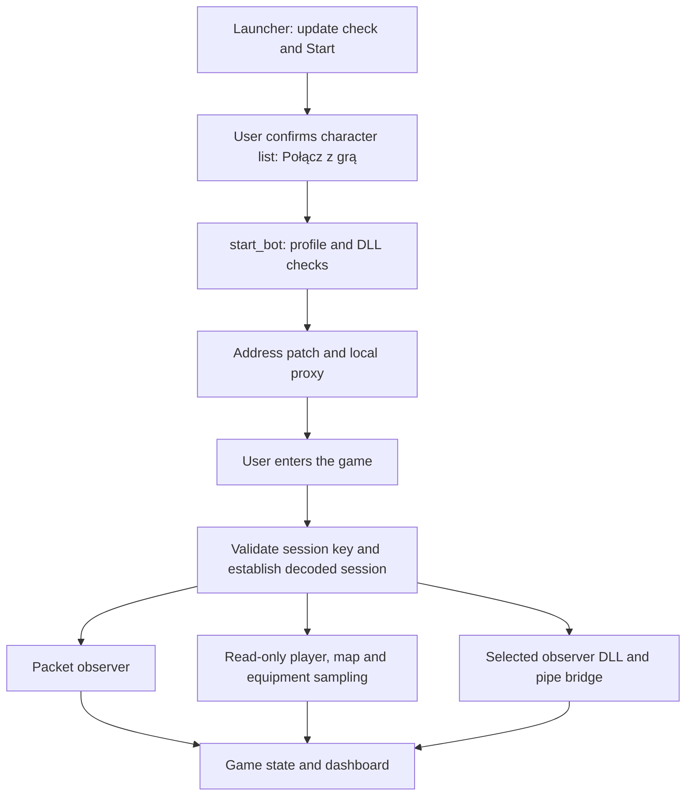

# Updating the bot after a DBVictory client update

This is the maintenance procedure for the Windows installation at
`D:\Projekty\tibia-ots-mcp-bot` and the client at `D:\Gry\DBVClient_v5`.
Run the commands in **Windows PowerShell**. Adjust the paths if either folder moves.

**Working baseline:** v1.38.3, commit
`a9901185dabc1967cfbaa14e95af0fade4221869`. On 2026-11-26 the operator confirmed
that it was working after the fresh-login test. This resolves the reported
connection/HP/Ki observation problem. It is not a separate test of every action,
native marker behavior or recovery scenario.

The exact executable/DAT/DLL hashes, address evidence and test results for that
build are in [the November 26 compatibility record](CLIENT_UPDATE.md).
Use this guide for the **process**, and keep a separate evidence record for
each future client build.

## Quick route through an update

1. Identify the new executable and DAT hashes; preserve the working baseline.
2. Prepare changes in a separate checkout. Keep the running installation intact.
3. Verify the new memory layout, protocol startup and native marker layout.
4. Add regression tests, update the profile and all applicable consumers, then
   build the matching DLL and run offline checks.
5. Install during a maintenance window. Ordinary Python/UI updates use the
   release queue; DLL/native/dependency updates need a separate installation.
6. Start from the character list, confirm connection manually, and compare
   observations before enabling automation.
7. Record the tested commit, hashes, results and any remaining limitations.

There is no supported one-click offset updater. Hashing, builds, synthetic
tests and packaging are repeatable; new addresses and object layouts still
need evidence from the new executable. Never make an unknown build pass by
replacing an old profile's hash while retaining unverified offsets.

## 1. Understand the connection path



The launcher does **not** take screenshots or recognize the character list.
The click is the user's confirmation. It checks the client window/process and
asks again if that process changes. Keep this manual behavior.

Packet counters count forwarded traffic. Increasing counters do **not** prove
decryption, a game session, HP/Ki sampling or a working DLL. This distinction
was the cause of the misleading dashboard during the November 26 repair.

For the November 26 build, `client_protocol.py` reads the existing XTEA key
from the verified process using read-only access. `proxy.py` confirms it against
two server frames before starting observation. The selected PID, executable,
signatures, protocol type and stable fields must agree. Older builds retain
their RSA path. A future client might change either memory layout or framing;
neither should be assumed compatible.

## 2. File map

Paths below are relative to the bot repository. These are the files on the
client-update path; an update need only change the ones its evidence requires.

### Client identity and memory readers

| File | Responsibility / what to review |
| --- | --- |
| [client_profiles.py](../client_profiles.py) | Exact executable and DAT hashes, map/type/vtable RVAs, `PlayerLayout`, observer DLL and pipe. Register a new profile in `PROFILES`; retain previous entries. |
| [check_client_build.py](../check_client_build.py) | Offline PE/DAT/signature/DLL checker. Add checks for the new build, not just its hash. At v1.38.3 only `NOVEMBER_26` has the 35 detailed code/type checks. |
| [passive_map_win32.py](../passive_map_win32.py) | Finds one `dbvStart.exe`, identifies its executable, opens QUERY/VM_READ access and exposes the loaded base/PID. No process writes. |
| [passive_map.py](../passive_map.py) | Map/tree/vector/thing decoding and polling; executable/DAT/server scope for observations. Review embedded object-field assumptions when structures change. |
| [client_player_state.py](../client_player_state.py) | LocalPlayer identity, HP/Ki/level, facing, conditions, speed and stable snapshots. Contains an explicit supported-profile list as well as fields outside `PlayerLayout`. |
| [client_equipment.py](../client_equipment.py) | Equipment and open-container structures. Contains another explicit supported-profile list; inventory offset alone is insufficient if container layouts change. |
| [client_protocol.py](../client_protocol.py) | November 26 protocol object, accessor signatures, encryption flag and key fields. Currently explicitly restricted to `NOVEMBER_26`. |

### Proxy and session startup

| File | Responsibility / what to review |
| --- | --- |
| [mcp_server.py](../mcp_server.py) | `start_bot` preflight, address patching, proxy creation and login callbacks. Explicitly enables the native key reader for `NOVEMBER_26`; a new profile needs deliberate wiring. |
| [patcher.py](../patcher.py) | Finds and patches the remote server address in client memory. A successful patch alone does not establish a session. |
| [constants.py](../constants.py) | Server host and environment-controlled network ports. Confirm actual endpoint changes; do not guess them from a client version. |
| [proxy.py](../proxy.py) | Framing/forwarding, RSA fallback, native-key confirmation, exact known login envelope and connection cleanup. Never log keys or raw login bytes. |
| [crypto.py](../crypto.py), [protocol.py](../protocol.py) | XTEA/checksums/RSA and packet opcodes/readers/builders. Change only if new protocol evidence requires it. |
| [packet_observer.py](../packet_observer.py), [game_state.py](../game_state.py) | Bounded asynchronous decryption/parsing and state publication. Preserve initial frames and session ownership. |
| [session_startup.py](../session_startup.py), [session_lifetime.py](../session_lifetime.py), [session_observations.py](../session_observations.py) | Login work, session lifetime and observation freshness. Keep disconnect/relogin invalidation intact. |

### Native observer and marker

| File | Responsibility / what to review |
| --- | --- |
| [dll/observer_layout.h](../dll/observer_layout.h) | Build-specific C++ map/Game/vtable addresses, marker fields/functions, PeekMessageA locations and pipe. Must agree with the Python profile. |
| [dll/marker_observer.cpp](../dll/marker_observer.cpp) | Current observer source: bounded creature/map reads and pipe service. Also contains structural offsets outside the layout header. |
| [dll/target_marker.h](../dll/target_marker.h) | Visual square only, full setter signatures, reviewed game-thread hook, ownership/expiry/manual-selection checks. Review ABI and entire function bodies before changing. |
| [build_dll.ps1](../build_dll.ps1) | Selects the source, compile definition and output filename. Extend its `ValidateSet` and branches for a new build. The default builds the legacy DLL. |
| `dll/dbvobserver_marker_20261126.dll` | Generated x86 artifact for the working build. DLLs are Git-ignored: a source commit/clone does not include this binary. Build, hash and deliver it separately. |
| [inject.py](../inject.py) | Windows DLL loading and target bitness checks; normally unchanged by an address relocation. |
| [actions/dll_bridge.py](../actions/dll_bridge.py) | Selects the profile's DLL for injection and starts the bridge. Preserve profile selection through retries. |
| [dll_bridge.py](../dll_bridge.py) | Selects the profile's named pipe and handles the protocol. A DLL/pipe mismatch can leave the bridge inactive even if the DLL loaded. |

`dll/dbvbot.cpp`, `dll/observer.cpp`, `dll/target_observer.cpp` and
`dll/target_sync.h` are older/alternate implementations, not the November 26
marker build. `offsets.json` still has legacy/parser settings but is **not**
the authoritative profile for the current native memory readers.
`xtea_finder.py` is not the v1.38.3 startup key reader. Editing only one of these
older files will not adapt the current connection path.

### Launcher, dashboard and distribution

| Files | Responsibility / what to review |
| --- | --- |
| [Uruchom bota.cmd](../Uruchom%20bota.cmd), [launcher/Desktop.cs](../launcher/Desktop.cs), [launcher/build_desktop.ps1](../launcher/build_desktop.ps1) | Entry point and generated `DBVictory Launcher.exe`. Rebuild the EXE only when its compiled behavior/resources require it. |
| [launcher/desktop/host.js](../launcher/desktop/host.js), [effects.js](../launcher/desktop/effects.js), [main.js](../launcher/desktop/main.js), [bridge.js](../launcher/desktop/bridge.js), [render.js](../launcher/desktop/render.js) | Updater/Python invocation, client-process checks, manual Connect flow and launcher UI. `index.html` and `style.css` provide its view. |
| [launcher/desktop_session.py](../launcher/desktop_session.py), [run_bot.py](../run_bot.py), [run_mcp.py](../run_mcp.py) | Desktop session, engine launch and MCP entry. The desktop game port is currently 7475; direct MCP defaults can differ. |
| [launcher_files.py](../launcher_files.py), [launcher/UpdateWindow.cs](../launcher/UpdateWindow.cs) | File-only preflight and updater window. `preflight --check` does not install anything. |
| [dbv_release.py](../dbv_release.py), [launcher_lock.py](../launcher_lock.py), [dbv_revision.py](../dbv_revision.py), [launcher_panel_build.py](../launcher_panel_build.py) | Exact-commit packaging, locks, version calculation and renderer builds. Native/dependency changes intentionally require separate maintenance. |
| [launcher/desktop/release-notes.json](../launcher/desktop/release-notes.json) | User-facing release notes. Each commit advances the displayed version, including documentation commits. |
| [dashboard_api.py](../dashboard_api.py), [dashboard_security.py](../dashboard_security.py), `dashboard/app/`, `dashboard/electron/` | Observations/status UI, authenticated local APIs and Electron shell. Usually no changes for an offset-only update. |
| [dashboard/electron/tray.js](../dashboard/electron/tray.js), [tray_exit.py](../tray_exit.py) | **Zakończ bota** requests engine exit. Window X only hides the panel. |

### Tests and evidence

| Files | Coverage |
| --- | --- |
| [tests/test_client_profiles.py](../tests/test_client_profiles.py), [tests/test_client_november_26.py](../tests/test_client_november_26.py) | Exact identity, rejected builds, shifted stats/equipment, Python/C++ agreement, selected DLL/pipe and startup ordering. Use the latter as a pattern for a new build-specific test file. |
| [tests/test_client_protocol.py](../tests/test_client_protocol.py) | Synthetic keys/frames, wrong identity/signatures, torn reads, two-frame confirmation, forwarding order, initial-frame delivery, reconnect cleanup and redaction. |
| [tests/test_client_player_state.py](../tests/test_client_player_state.py), [tests/test_passive_map.py](../tests/test_passive_map.py), [tests/test_player_updates.py](../tests/test_player_updates.py) | Stable native observations and packet/state behavior. |
| [tests/test_dll_pipe.py](../tests/test_dll_pipe.py), [tests/test_native_target_sync.py](../tests/test_native_target_sync.py) | Pipe selection, handle behavior, restricted commands and marker dispatch. |
| [dll/test_target_marker.cpp](../dll/test_target_marker.cpp), [dll/test_marker_observer.cpp](../dll/test_marker_observer.cpp) | Synthetic native marker/observer checks; compile and run as x86 executables on Windows. |
| [tests/test_packet_observer.py](../tests/test_packet_observer.py), [tests/test_relogin_identity.py](../tests/test_relogin_identity.py), [tests/test_automation_safety.py](../tests/test_automation_safety.py) | Observer queue, fresh identity and automation guards. |
| [tests/desktop_launcher.test.cjs](../tests/desktop_launcher.test.cjs), [tests/test_desktop_session.py](../tests/test_desktop_session.py), [tests/test_launcher_preflight.py](../tests/test_launcher_preflight.py), [tests/test_dbv_release.py](../tests/test_dbv_release.py) | Manual Connect, preparation, updater and release boundaries. |
| [CLIENT_UPDATE.md](CLIENT_UPDATE.md), [CODEX.md](CODEX.md), [README.md](../README.md) | Build-specific evidence, operating instructions and entry links. Keep status claims consistent. |

## 3. Record identity and preserve a rollback baseline

These commands only inspect files; the game can remain open for this step.

```powershell
$bot = 'D:\Projekty\tibia-ots-mcp-bot'
$client = 'D:\Gry\DBVClient_v5\dbvStart.exe'
$dat = 'D:\Gry\DBVClient_v5\bytes\things\file.dat'
git -C $bot rev-parse HEAD
git -C $bot status --short
Get-FileHash -Algorithm SHA256 $client, $dat
& "$bot\venv\Scripts\python.exe" -B -X utf8 "$bot\launcher_files.py" preflight --check
```

Record the full bot commit, client/DAT hashes, DLL hash/name, Python version,
compiler/flags and test outcomes in the new build's evidence document.
Do not commit the proprietary client executable or authenticated captures.

Before replacing files, log out, close the client and launcher, and use the
bot tray menu **Zakończ bota**. Preserve a private local backup of:

- Bot source/history and the matching generated DLLs/launcher; `git bundle`
  preserves committed history, **not** uncommitted or ignored files.
- `bot_settings.json`, `recordings/`, `local_data/`, and any private local
  configuration, including untracked files.
- Local client assets such as `dashboard/public/local-spells/`, plus the runtime
  configuration needed to recover `venv` and the local Node/Electron installation.
- The old client/DAT files if already retained locally. An old bot with a new
  client is not necessarily a usable rollback.

Keep backups outside version control. Do not use `git reset --hard`,
`git clean -fdx`, or a whole-directory overwrite on the user's installation.
Review overlapping local changes rather than deleting/stashing them blindly.

## 4. Prepare a separate candidate and verify the layout

Create a local clone/worktree on a `codex/` branch from the installed revision.
Use a Windows-accessible directory such as
`D:\Projekty\DBVictory-work\client-YYYYMMDD`; keep its dependency environment
separate from the running installation. Read [AGENTS.md](../AGENTS.md) first.

For example, with `$bot` set as in step 3 and a working installed Python:

```powershell
$stamp = Get-Date -Format 'yyyyMMdd'
$work = "D:\Projekty\DBVictory-work\client-$stamp"
git clone --no-hardlinks $bot $work
if ($LASTEXITCODE -ne 0) { throw 'Candidate directory was not created; inspect before continuing' }
git -C $work switch -c "codex/client-$stamp"
if ($LASTEXITCODE -ne 0) { throw 'Cannot create candidate branch' }
& "$bot\venv\Scripts\python.exe" -m venv "$work\venv"
if ($LASTEXITCODE -ne 0) { throw 'Cannot create candidate Python environment' }
Set-Location $work
```

This copies committed source history. It does not copy the installation's
uncommitted changes, settings, generated DLLs or dashboard dependencies. If the
destination already exists, inspect it and choose another name instead of
overwriting it. If the installed source advances while you work, reconcile the
candidate before publication; the release must descend from the installed HEAD.

Compare the new executable with the last verified build using static PE
analysis/disassembly. Tools such as a disassembler, RTTI inspection, or a local
Python analysis environment can help; there is no maintained automatic offset
discovery command in this repository. Temporary analysis helpers are not part
of the release contract.

For each address record its RVA, field width/layout, source of evidence and
expected bytes/type. Follow Lua registration strings to bindings/accessors,
MSVC RTTI to vtables, and constructors/getters to object fields. Do not apply a
single address delta across the executable. Distinguish **RVA** from absolute
virtual address and file offset; runtime addresses use the loaded module base.

Review these groups independently:

1. Map singleton, center, block/tree/vector layouts, item types and all vtables.
2. LocalPlayer HP/Ki/level layout, conditions, speed and direction. Verify widths
   (for example, doubles versus integers, and byte creature-health percentage).
3. Inventory/shared-pointer slots, Game containers and container structures.
4. ProtocolGame shared pointer/vtable, XTEA fields, encryption flag and accessors.
5. Visual-square fields/setters, calling convention, PeekMessageA import and
   reviewed call sites. Preserve manual selection and bounded marker ownership.
6. DAT identity, loaded item semantics and actual server/port configuration.

Add failing synthetic regression tests **before** changing behavior. Derive
expected values from the reviewed executable evidence, not solely from copying
the implementation's constants into a fixture.

## 5. Update every affected consumer

Add a new named profile instead of editing `NOVEMBER_26`. Then check this list:

- Register it in `client_profiles.PROFILES`, including its verified DAT digest,
  new DLL filename and matching pipe name.
- Review `ClientPlayerReader` and `EquipmentReader` supported-profile lists and
  embedded field layouts. Retain identity, bounds, freshness and torn-read checks.
- Add build-specific native-key evidence/selection in `client_protocol.py` and
  wire it in `mcp_server.py` if that key path is appropriate. Merely adding a
  `ClientProfile` does **not** activate native key reading.
- Review `proxy.py`'s recognized login envelope. For the working build it is
  checksummed, 137 bytes, opcode 10, OS 10, version 372. These are observed
  build-specific facts, not universal protocol constants. Retain key confirmation,
  connection reset and forwarding-before-analysis behavior.
- Add the new C++ layout, build define, output name and pipe to
  `dll/observer_layout.h` and `build_dll.ps1`. Review structures in the observer
  and marker sources as well. A missing new define currently selects the older
  layout through `#else`; verify the artifact rather than trusting its filename.
- Extend `check_client_build.py` with independent code/type checks. An unknown
  hash should fail. A newly registered profile with **zero static checks** is
  not a completed compatibility verification.
- If the DAT changed, review item definitions and locally exported graphics/
  catalogue. Preserve old observations on disk; do not relabel old learned
  transitions or manual confirmations as evidence for a new scope.
- Add a short release note and update the evidence document with exact results.

Do not weaken hash/signature checks, change memory permissions, re-enable legacy
hooks, or reintroduce screenshot detection to make an unsupported build start.

## 6. Build and test without connecting to the game

Use Windows Python for native compatibility checks and Node.js 22 for development
checks. Linux synthetic tests are useful, but do not prove Windows attachment.
Install `requirements-dev.txt` into the **candidate's** test environment.

From the candidate root, these are the working November 26 commands:

```powershell
.\venv\Scripts\python.exe -m pip install -r requirements-dev.txt
.\build_dll.ps1 -ClientVersion 20261126
.\venv\Scripts\python.exe check_client_build.py 'D:\Gry\DBVClient_v5\dbvStart.exe' --dll '.\dll\dbvobserver_marker_20261126.dll'
.\venv\Scripts\python.exe -m pytest -q tests/test_client_profiles.py tests/test_client_november_26.py tests/test_client_protocol.py tests/test_client_player_state.py tests/test_passive_map.py tests/test_dll_pipe.py tests/test_native_target_sync.py tests/test_packet_observer.py tests/test_relogin_identity.py tests/test_automation_safety.py
.\venv\Scripts\python.exe -m pytest -q
node --test tests/desktop_launcher.test.cjs
git diff --check
Get-FileHash -Algorithm SHA256 '.\dll\dbvobserver_marker_20261126.dll'
```

For a future build, first implement the new build selector and test file, then
substitute their names. The script currently accepts only `legacy`, `20261116`
and `20261126`; inventing a date argument will not build new support.
`20261116` selects the older `dbvobserver_marker_20261117.dll`; the default
`legacy` selects `dbvbot.dll`. Use an x86 compiler, even with 64-bit Windows/Python.

Compile and execute the two synthetic native tests using the matching define;
see [the exact November 26 commands](CLIENT_UPDATE.md#repeatable-offline-checks).
If dashboard code changes, also run `npm ci`, `npm test`, `npm run typecheck`
and `npm run build` in the candidate's `dashboard/`, following its lockfile.

Inspect every command's exit status. Do not call `start_bot`, inject a DLL or
enable actions as an offline smoke test. `run_mcp.py` plus read-only `get_status`
and `list_actions` can check MCP without connecting. Use synthetic fixtures;
never save keys, credentials or unrestricted authenticated packet payloads.

The working v1.38.3 integration did not make the full suite green: its final
Linux run had 1767 passed, 23 skipped and 2 failures (a reproduced transport
baseline failure and an intermittent cavebot timeout). See the evidence record.
Investigate new failures against the baseline; do not automatically classify
every future failure as one of these known issues.

## 7. Install the tested revision

Commit the reviewed candidate and record its full SHA. Confirm the source tree
matches that commit and the separate DLL was built from the corresponding
source. Never mix arbitrary source files and an older native artifact.

### A. Ordinary Python, launcher JavaScript or documentation update

Use the existing publisher from **native Windows Python**, including when
orchestrating from WSL. Windows and Linux file locks are not interchangeable.

```powershell
$bot = 'D:\Projekty\tibia-ots-mcp-bot'
$work = 'D:\Projekty\DBVictory-work\client-YYYYMMDD' # replace with the real candidate
$revision = git -C $work rev-parse HEAD
if ($LASTEXITCODE -ne 0) { throw 'Cannot identify candidate' }
& "$bot\venv\Scripts\python.exe" "$bot\dbv_release.py" --installation $bot publish $work $revision
if ($LASTEXITCODE -ne 0) { throw 'Release was not queued' }
& "$bot\venv\Scripts\python.exe" -B -X utf8 "$bot\launcher_files.py" preflight --check
```

Publishing queues a local package; it does not replace the running engine.
`busy` means wait. Log out/close the client, choose **Zakończ bota**, and reopen
`DBVictory Launcher.exe` to install. If a renderer build is required, publication
builds it from the candidate; prepare its dependencies first.

### B. New DLL, native source, compiled launcher or dependency update

The publisher intentionally rejects these changes, including `dll/` native
sources and `build_dll.ps1`. Do not remove that restriction. This path requires
an explicit maintenance window with client, engine and launcher closed.

1. Preserve the baseline and private files from step 3. Inspect updater status;
   finish/reconcile any pending transaction before manual maintenance. Confirm
   there is no active bot process or occupied bot port; do not delete locks to
   force installation.
2. Review the exact source diff and generated-artifact manifest. Check local
   modifications for overlap. Prepare required runtimes/dependencies separately.
3. Fast-forward the installation to the tested source commit. For a local
   candidate clone, the source-only operation is:

   ```powershell
   $bot = 'D:\Projekty\tibia-ots-mcp-bot'
   $work = 'D:\Projekty\DBVictory-work\client-YYYYMMDD' # replace with the real candidate
   $revision = git -C $work rev-parse HEAD
   if ($LASTEXITCODE -ne 0) { throw 'Cannot identify candidate' }
   git -C $bot fetch --no-tags $work $revision
   if ($LASTEXITCODE -ne 0) { throw 'Cannot fetch tested source' }
   git -C $bot merge --ff-only $revision
   if ($LASTEXITCODE -ne 0) { throw 'Stop: source update needs review' }
   ```

4. Copy only the separately built artifacts named in the reviewed manifest to
   their intended paths. For a new profile, give its DLL a distinct name and
   retain previous DLLs. Record/compare SHA-256 before and after copying. Git
   cannot install ignored DLLs, generated EXEs or dependency environments.
5. Repeat the offline build checker against the installed client and installed
   DLL, inspect Git status and compare the preserved user-file hashes. Do not
   start while source, DLL, pipe, runtime or dashboard versions disagree.
6. Open the ordinary launcher and perform the fresh-login test below.

There is no universal native-install command in this repository. The commands
above update source only; the maintainer must supply and verify the exact
artifact list. Do not replace a DLL in a running client: a loaded module can
remain resident until client exit.

## 8. Fresh-login acceptance

The operator performs login and approves any gameplay tests. Saved non-combat
actions, including healing, can resume after login; review them before testing.

1. Open `DBVictory Launcher.exe`; verify the installed version/commit.
2. Click **Start** and log in to the **character list**.
3. Click **Połącz z grą** once the character list is open. Wait for the bot
   panel's **Zaloguj się do gry** prompt, then enter the character.
4. Confirm the game-session indicator, increasing processed observations,
   fresh HP/Ki/level/position matching the game, and expected DLL/bridge status.
   Forwarded counters alone are insufficient. Percent display may legitimately
   show 100/100; do not assume those are absolute resource points.
5. Compare equipment, visible creatures, map and facing. Observe a natural
   update or operator-controlled movement before claiming continuous readings.
6. Test the visual marker and each requested action separately, then reconnect
   if that test was agreed. Do not claim untested features from a successful login.

Record what was checked, by whom and on which client/DAT/commit. A user report
of success and an agent-observed measurement are different evidence; label them.

## 9. Troubleshooting by symptom

| Symptom | Check next |
| --- | --- |
| “Nie udało się wykonać lokalnego aktualizatora. Sprawdź instalację Pythona.” | Run `venv\Scripts\python.exe --version` and `launcher_files.py preflight --check` directly. Inspect `venv\pyvenv.cfg` for a missing base interpreter. In this repair it referenced a removed Codex runtime. Restore a compatible Python or rebuild the environment while stopped; this error does not establish a bad client offset. |
| Missing Git/version information | Run `git --version`; inspect `dbv_revision.git_executable()` search paths. Git is required by the local publisher/version checker. |
| “Wersja klienta zmieniła się…” | Hash the actual running executable, not another copy in Downloads. Add a fully verified profile; do not bypass the rejection. |
| Character-list detection text keeps cycling | Check that v1.38.2-or-later manual Connect files are installed and the loaded launcher is current. Screenshot recognition was removed. |
| Packets increase, session inactive, observations 0, HP/Ki blank | Check the handshake first. November 26 logged “Could not find RSA block in login packet!”; v1.38.3 added the native key path. Verify its profile wiring, selected PID, stable fields and frame confirmation. |
| “Client protocol key could not be confirmed” | Recheck protocol layout, login envelope, checksum/framing and whether the process changed. Confirmation stops after eight attempts for that connection; do not bypass it. A corrected engine needs a fresh login. |
| Session active, HP/Ki still blank or stale | Inspect LocalPlayer identification, stats offsets/types and freshness. HP/Ki native sampling is separate from merely forwarding/decrypting packets. |
| Session active, DLL/bridge inactive | Compare selected DLL filename, bitness, pipe and C++ build definition; check injection status and process permissions. An old resident DLL requires client exit. |
| Map/equipment wrong while HP works | Check their own vtables/structures and DAT scope; do not shift all offsets together. |
| Update says `busy` after closing the window | X hides the dashboard. Use tray → **Zakończ bota**, close the launcher and recheck. Do not force-kill an unidentified Python/Electron process. |
| “Osobna aktualizacja zależności lub DLL” during publish | Use maintenance path B; the native/dependency guard is working as intended. |

Local `.codex/standalone-stderr.log` and `dll_bridge_debug.txt` can help with
startup stages. Inspect a bounded, allowlisted excerpt. Older logs may contain
raw login bytes from earlier logging code: do not paste/upload whole logs.
Never print a session key as a diagnostic. Keep payload capture disabled unless
the operator explicitly requests it and its handling is agreed.

## 10. Rollback and handoff

If acceptance fails, stop automation, log out normally, exit the bot and close
the client before changing files. For a queued release not yet installed,
**Odłóż wydanie** may keep the current installation when the updater permits it.
That is deferral, not rollback of an installed release.

For an installed release, restore the matched source/DLL/runtime artifacts from
the reviewed baseline while preserving current private data. The publisher
requires forward ancestry; it is not an arbitrary old-commit installer. A
reviewed revert commit or explicit maintenance restore may be necessary. The
old bot must still match the client executable/DAT; if the server requires a
new client, remaining stopped may be the only valid outcome until support is fixed.

A completed update record contains:

- Full source commit/version, executable/DAT hashes, DLL name/hash/pipe.
- Address/signature evidence and the exact files changed.
- Compiler/build commands and test commands/results, including failures/skips.
- Installation method, preserved user files and a viable rollback baseline.
- Actual Windows checks and operator acceptance; separately list untested features.

For the next assisted update, a useful task brief is:

> Adapt the bot in `D:\Projekty\tibia-ots-mcp-bot` to the new client in
> `D:\Gry\DBVClient_v5`. Follow `docs/CLIENT_UPDATE_GUIDE.md` and `AGENTS.md`.
> Preserve old profiles and private data, derive new layouts from evidence,
> add tests and prepare the matching artifacts in a separate checkout. Keep
> character-list confirmation manual. Prepare offline checks and a concrete
> installation package first; coordinate a stopped maintenance window for
> native replacement and a fresh-login test. Do not start the live bot or
> enable gameplay actions as a smoke test.
